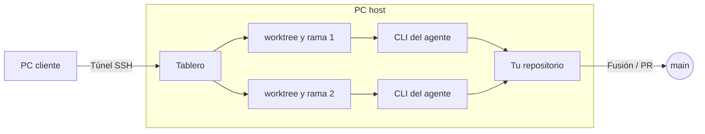

<div align="center">


# Worktree Kanban

<strong>Un tablero para combinar agentes de programación con IA en diagramas de flujo, donde las decisiones clave las toman las personas.</strong><br />
Implementa con Codex, revisa con Claude y devuelve el trabajo si hace falta. Tú decides si se fusiona.

[Sitio web](https://kazuya83.github.io/worktree-kanban/) · [Descargar](https://github.com/kazuya83/worktree-kanban/releases/latest)

[](https://github.com/kazuya83/worktree-kanban/releases/latest)
[](https://github.com/kazuya83/worktree-kanban/releases/latest)
[](docs/images/en/feature-pipeline.gif)
[](https://github.com/kazuya83/worktree-kanban#readme)
[](LICENSE)

[English](README.md) · [日本語](README.ja.md) · [Español](README.es.md) · [Français](README.fr.md) · [简体中文](README.zh-CN.md)

</div>

<div align="center">


</div>

Aplicación de escritorio (Electron, Mac / Windows / Linux) que ejecuta en paralelo las CLI de agentes de programación con IA (Claude Code / Codex CLI / Antigravity CLI / Gemini CLI / Cursor CLI / OpenCode / Copilot CLI / Amp / Pi / Droid), cada tarea en su propio git worktree, y las gestiona en un tablero kanban. **No solo ejecuta tareas dentro de un repositorio: también puede ejecutar a la vez tareas de varios repositorios.**


## ¿Por qué Worktree Kanban?

- **Agentes en un diagrama de flujo** — describe un flujo en lenguaje natural o dibújalo, y los agentes se pasan el trabajo paso a paso, siguiendo ramas, bucles y pasos en paralelo.
- **Tú decides** — revisa el diff antes de fusionar o abrir un PR. Con Claude Code, Codex y Cursor, también apruebas las acciones en la tarjeta.
- **Una tarea, un worktree** — cada tarea tiene su propio worktree de git y su rama, así que no chocan entre sí ni con tu árbol de trabajo.
- **Varios repositorios a la vez** — abre hasta 3 repositorios en pestañas; cambiar de pestaña no detiene nada.
- **Las CLI que ya usas** — Claude Code, Codex CLI, Antigravity CLI, Gemini CLI, Cursor CLI, OpenCode, Copilot CLI, Amp, Pi y Droid, con tu sesión y tu configuración actuales.
- **Control remoto Mac ⇄ Windows** — ejecuta los agentes en un PC y maneja el mismo tablero desde el otro: aprueba, responde preguntas, envía instrucciones y fusiona.
- **Todo en local** — el estado del tablero se queda en tu máquina. No hay un servidor externo. Con los servicios que conectes, tu máquina se comunica directamente.

## Cómo funciona



- **1 tarea = 1 worktree = 1 rama.** Crea un worktree en `<repo>.worktrees/<id>`, junto al repositorio, y trabaja en una rama `agent/<resumen>-<id>`. Las tareas no chocan entre sí ni con el árbol de trabajo que tienes abierto
- **El agente es la CLI, arrancada tal cual.** Claude Code se ejecuta con `claude -p --input-format stream-json --output-format stream-json`, y su salida se muestra en la tarjeta como registro. El inicio de sesión, el modelo, `CLAUDE.md` y las skills son los mismos que usas en la terminal
- **La aprobación pasa por `--permission-prompt-tool` de Claude Code, `codex app-server` de Codex y `cursor-agent acp` de Cursor.** Solo las acciones que el modo de permisos o `--allowedTools` (el ajuste de herramientas permitidas de Worktree Kanban) no autoriza automáticamente aparecen en la tarjeta como espera de aprobación
- **Al terminar, incorporas el trabajo con un merge (`--no-ff`) o creando un PR / MR (`gh` en GitHub, la API en GitLab).** Puedes elegir la rama de destino y, después del merge, hacer push a origin
- El estado del tablero se guarda en `board.json`, en la carpeta userData de Electron. No hay un servidor externo

En Codex / Antigravity / Gemini / Cursor / OpenCode / Copilot / Amp / Pi / Droid, por los límites de la CLI, no están disponibles las preguntas de opción múltiple, btw ni el coste. La aprobación en la tarjeta funciona en Codex y Cursor, pero no en Antigravity, Gemini, OpenCode, Copilot, Amp, Pi ni Droid (más detalles en [docs/agents.md](docs/agents.md) (English)).

## Funciones principales

### Operar desde otro PC (RC)

Puedes manejar el tablero del PC que ejecuta los agentes (el host) desde Worktree Kanban en otro PC (el cliente). Tanto Mac como Windows pueden ser el host, y cualquiera de los dos puede ser el cliente. En el cliente puedes aprobar, responder preguntas, enviar instrucciones adicionales, hacer merge, etc., igual que en la pantalla del host.


- La aplicación del host solo escucha en `127.0.0.1`. La del cliente conecta con un túnel `ssh -N -L`, así que en el host solo hace falta un servidor SSH. Para conectar desde fuera, usa Tailscale u otra red similar
- SSH entra con una clave. En los «Ajustes de RC» del cliente, crea una clave ed25519 (`~/.ssh/agent-kanban_ed25519`) y registra la clave pública en los «Ajustes de RC» del host
- La primera vez se empareja con un código de 6 dígitos que aparece en el host. Después, un token guardado vuelve a conectar con el destino anterior


Los pasos, y cómo arreglar una conexión que falla, están en [docs/remote.md](docs/remote.md) (English).

### Usar desde el teléfono
Desde cualquier lugar, puede ver el tablero en el navegador del teléfono (Safari en iPhone, Chrome en Android), crear tareas, enviar instrucciones adicionales, aprobar y responder preguntas. No hace falta instalar nada en el teléfono.

- La aplicación del PC inicia [Cloudflare Tunnel](https://developers.cloudflare.com/cloudflare-one/connections/connect-networks/) (`cloudflared`, gratuito) y crea una URL HTTPS. No hace falta abrir puertos en el router. Elija un Quick Tunnel sin cuenta, o un túnel con nombre cuya URL no cambia
- Pulse «Teléfono» arriba, luego «Conectar un teléfono», y escanee el código QR con el teléfono. Los tokens caducan a los 30 días, y puede revocar un teléfono conectado cuando quiera
- Fusionar, los PR y cambiar la configuración no están disponibles desde el teléfono. Los agentes siempre se ejecutan en el PC, y solo funciona mientras la aplicación está abierta en el PC

Los pasos, y cómo arreglar una conexión que falla, están en [docs/mobile.md](docs/mobile.md) (English).

Además: cambiar el estado (columna) de una tarjeta arrastrándola, mensajes a un agente en ejecución (btw), adjuntar imágenes y archivos, competición (varios agentes resuelven la misma tarea), y repositorios de WSL en Windows. El uso está resumido en [docs/usage.md](docs/usage.md) (English).

### Pipeline: describe un flujo en lenguaje natural y ejecuta tareas con él
Escribe el flujo que quieres en lenguaje natural, por ejemplo «implementar con Codex, revisar con Claude y volver a la implementación si hay cambios que hacer», y el agente construye el diagrama de flujo. Elige ese Pipeline al crear una tarea y los agentes se pasarán el trabajo paso a paso, siguiendo sus ramas y bucles. También puedes editar el diagrama a mano.


Los detalles están en [docs/agents.md](docs/agents.md) (English).

### Subtareas
Cuando una tarea es grande, el agente puede proponer dividirla en subtareas. Salen de la rama padre, avanzan en paralelo o en orden y se fusionan a medida que terminan. También se puede iniciar una sola subtarea, y se admiten los sub-issues de GitHub, GitLab, Linear y Jira.


### Ejecutar varios repositorios en paralelo

Los repositorios se abren en pestañas (hasta 3). Cambiar de pestaña no detiene las tareas de los otros repositorios. Una pestaña que no está seleccionada muestra **cuántas tareas están en marcha** (azul) y **cuántas esperan tu respuesta** (aprobación, una pregunta, etc., en naranja), así que las pestañas bastan para ver qué repositorio te necesita. El límite de tareas simultáneas (el ajuste de cuántas ejecutar a la vez) se comparte entre todos los repositorios.


El «+» de la barra de pestañas, o pulsar la pestaña abierta, permite elegir entre los repositorios abiertos hace poco. Desde ahí también se puede clonar desde una URL o crear un repositorio nuevo.

Puedes abrir una carpeta que no es un repositorio git (producción de vídeo y otro trabajo que no es código). En ese caso la tarea se ejecuta directamente en la carpeta, sin crear un worktree, y se cierra con «Marcar como hecha» (más detalles en [docs/usage.md](docs/usage.md) (English)).


### Aprobación

Cuando una acción necesita permiso, puedes leer el comando y la entrada completos en la tarjeta y en el panel de detalle, y luego elegir permitir, rechazar o permitir siempre en esta tarea. Al rechazar, puedes devolver un motivo al agente.


<details>
<summary>Ver pantalla</summary>


</details>

### Integraciones (GitHub, GitLab, Linear, Jira, Slack)

Crea tareas desde Issues y mantén su estado sincronizado. También puedes publicar notificaciones en Slack e iniciar tareas desde Slack.

| Servicio | Entrada para la tarea | Cuerpo del PR / MR | Sincronización de estado | Qué necesitas para conectar |
| --- | --- | --- | --- | --- |
| GitHub | `21, 22, 24` | `Closes #21` | Status de GitHub Projects | `gh` |
| GitLab | `12`, `group/project#12`, URL | `Closes #12` | Etiquetas y abierto / cerrado | URL, Personal Access Token (`api`) |
| Linear | `ENG-123`, URL | `Ref ENG-123 <URL>` | Estado del flujo de trabajo | Clave de API |
| Jira | `ABC-123`, URL | `ABC-123 <URL>` | Transición | URL, y un token de API con correo (Cloud) o un Personal Access Token (Data Center) |

Construye las instrucciones a partir del título, el cuerpo y los comentarios del Issue, y crea una tarjeta por Issue. Las ramas se llaman como `agent/issue-21-…`. Los sub-issues funcionan con los cuatro servicios, y los comentarios de vuelta en el Issue, con GitLab, Linear y Jira.

- **GitLab**: funciona con gitlab.com y con instalaciones propias. Si origin pertenece al GitLab conectado, usa la API en lugar de `gh` para crear MR y comprobar fusiones, conflictos y resultados de pipeline
- **Linear y Jira**: solo gestionan issues. Los PR y MR se crean en el host del repositorio. Jira funciona con Cloud y Data Center
- **Slack**: publica finalizaciones, fallos y lo que espera tu confirmación. Los usuarios de Slack permitidos pueden iniciar una tarea con una mención o un comando de barra en un canal configurado. También pueden aprobar y responder preguntas con los botones de las notificaciones. De entrada, nadie puede hacerlo. Usa Socket Mode, así que no abre puertos, pero solo funciona con la aplicación abierta

Cómo configurarlo:

1. En «Ajustes» → «Integraciones», escribe la dirección y el token, y guarda. Los tokens se cifran con una clave del almacén seguro del sistema operativo
2. En «Ajustes» → «Enlace con Issues», elige «Gestor de issues que se usa» para cada proyecto
3. Escribe números o URL en la pestaña de Issue de «Nueva tarea»

Cómo crear la aplicación de Slack y los detalles de cada servicio están en [docs/integrations.md](docs/integrations.md) (English).


<details>
<summary>Ver pantalla</summary>


</details>

### Preguntas del agente

Cuando Claude Code pregunta con `AskUserQuestion`, la tarjeta pasa a ser una pregunta y aparece un formulario de respuesta. Se admiten la selección múltiple y el texto libre (Otro).


<details>
<summary>Ver pantalla</summary>


</details>

### worktree y diff

La pestaña «worktree» muestra los commits de la rama, los cambios sin commit, la relación con la base y los otros worktrees del mismo repositorio. En la pestaña «diff» eliges los archivos cambiados en un árbol agrupado por carpeta y ves el diff de cada archivo.


<details>
<summary>Ver pantalla</summary>


</details>

### Conversación

En «Conversación» puedes preguntar al agente sobre el repositorio sin crear una tarea (worktree). Las respuestas se muestran en Markdown. Cuando quieras que empiece a trabajar, «Convertir en tarea» continúa esa conversación como tarea.


<details>
<summary>Ver pantalla</summary>


</details>

### Notificaciones

La espera de aprobación, las preguntas, la espera de respuesta, la espera de revisión y la finalización se acumulan en el icono de la campana, arriba a la derecha, y también sale una notificación de escritorio. Al pulsar una notificación se abre esa tarea. También pueden ir a Slack (consulta «Integraciones» más arriba).


<details>
<summary>Ver pantalla</summary>


</details>

### Resolver conflictos

Si un merge entra en conflicto, la tarjeta pasa a ser un conflicto. Después de incorporar la rama base en la rama de la tarea, puedes pedir al agente que lo resuelva o corregirlo tú en un editor. En ambos casos, la rama base no cambia hasta que hagas el merge.


<details>
<summary>Ver pantalla</summary>


</details>

### Skills y conversaciones anteriores

Al crear una tarea puedes elegir una skill de Claude Code (se pasa como `/nombre-de-la-skill`). También puedes elegir una conversación anterior de Claude Code (sesión) y continuar desde ahí.


<details>
<summary>Ver pantalla</summary>


</details>

### Programador de tareas

Desde el menú de la barra superior, cambia a «Programador de tareas» para gestionar, en tarjetas, programaciones que crean y ejecutan una tarea en un momento dado (una vez, cada hora, cada día, cada semana o cada mes). Puedes registrar una tarea del kanban como programación, y también crear una tarea desde una programación en el momento. Las programaciones solo se ejecutan mientras la aplicación está abierta (más detalles en [docs/usage.md](docs/usage.md) (English)).


## Requisitos

- git
- La CLI del agente que uses (una de Claude Code / Codex CLI / Antigravity CLI / Gemini CLI / Cursor CLI / OpenCode / Copilot CLI / Amp / Pi / Droid), con la sesión ya iniciada
- `gh`, si usas Issues y PRs de GitHub (también se puede instalar desde la aplicación)
- Un token por cada servicio que conectes (GitLab, Linear, Jira, Slack). Para guardarlos hace falta el almacén seguro del sistema operativo (en Linux, GNOME Keyring, KWallet o similar). Los Issues y MR de un repositorio de GitLab no necesitan `gh`

## Instalación

**Mac / Linux**

```bash
curl -fsSL https://raw.githubusercontent.com/kazuya83/worktree-kanban/main/install.sh | bash
```

**Windows** (PowerShell)

```powershell
irm https://raw.githubusercontent.com/kazuya83/worktree-kanban/main/install.ps1 | iex
```

Los mismos comandos actualizan a la última versión. También se puede actualizar desde la aplicación: «Ajustes» → «Actualización de la aplicación» → «Actualizar a la nueva versión». Si marcas «Actualizar automáticamente cuando salga una versión nueva», se sustituye y se vuelve a abrir cuando no hay ninguna tarea en marcha. Para fijar una versión, desinstalar, instalar desde un archivo y el aviso del primer arranque, consulta [docs/install.md](docs/install.md) (English).

## Uso

1. En «Elegir repositorio», elige el repositorio git en el que trabajar (también puedes clonar desde una URL o crear uno nuevo)
2. En «Nueva tarea», escribe las instrucciones y créala
3. Cuando quede en espera de aprobación, permítela en la tarjeta
4. Cuando pase a la columna Revisión, comprueba el diff y pulsa «Merge» o «Crear PR»

## Documentación

| Documento | Contenido |
| --- | --- |
| [Pantalla y uso](docs/usage.md) (English) | Uso de cada función: aprobación, preguntas, comprobación de la especificación, programador de tareas, skills, conversación, btw, merge / PR, estado de los Issues, notificaciones, conflictos y más |
| [Agentes y orquestación](docs/agents.md) (English) | Diferencias entre Claude Code / Codex / Antigravity / Gemini / Cursor / OpenCode / Copilot / Amp / Pi / Droid, Pipeline y competición |
| [Ajustes](docs/settings.md) (English) | La pantalla de ajustes que se abre desde el menú de la barra superior, y sus apartados |
| [Integraciones](docs/integrations.md) (English) | Configurar GitLab, Linear, Jira y Slack, y qué pueden y no pueden hacer |
| [Control remoto](docs/remote.md) (English) | Cómo manejar el tablero desde otro PC por un túnel SSH, y cómo arreglar una conexión que falla |
| [Usar desde el teléfono](docs/mobile.md) (English) | Cómo manejar el tablero desde el navegador del teléfono desde cualquier lugar (Cloudflare Tunnel), y cómo arreglar una conexión que falla |
| [Modo residente](docs/headless.md) (English) | Mantenerlo en marcha sin ventana (también en un servidor Linux): el programador, Slack, la vigilancia de Issues y el host de control remoto |
| [Instalación](docs/install.md) (English) | Instalación, actualización, desinstalación y uso de un repositorio de WSL en Windows |
| [Para desarrolladores](docs/development.md) (English) | Ejecutar desde el código, compilar, publicar, cómo está hecha la aplicación y las pruebas |
| [Migrar desde Vibe Kanban](https://kazuya83.github.io/worktree-kanban/migrate-from-vibe-kanban.html) (English) | Qué cambió en Vibe Kanban, qué se conserva y los pasos para migrar |
| [Migrar desde Conductor](https://kazuya83.github.io/worktree-kanban/migrate-from-conductor.html) (English) | Qué cambia en Conductor, cómo exportar los datos de Cloud, qué se conserva y los pasos para migrar |

## Contacto

- **Autor en GitHub**: [@kazuya83](https://github.com/kazuya83)
- **Correo**: [kzy83ishi15@gmail.com](mailto:kzy83ishi15@gmail.com)
- **Issues**: [worktree-kanban/issues](https://github.com/kazuya83/worktree-kanban/issues) — informes de errores y solicitudes de funciones

## Licencia

Publicado bajo la [Functional Source License 1.1 (FSL-1.1-ALv2)](LICENSE). Puedes usarlo, modificarlo y redistribuirlo para cualquier fin, salvo un producto o servicio comercial competidor. Cada versión pasa a estar disponible bajo la Apache License 2.0 dos años después de su publicación.
