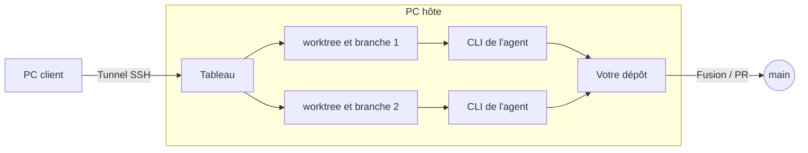

<div align="center">


# Worktree Kanban

<strong>Un tableau pour enchaîner des agents de code IA en organigrammes, où les humains prennent les décisions clés.</strong><br />
Implémentez avec Codex, relisez avec Claude et renvoyez le travail si besoin. La fusion reste votre décision.

[Site web](https://kazuya83.github.io/worktree-kanban/) · [Télécharger](https://github.com/kazuya83/worktree-kanban/releases/latest)

[](https://github.com/kazuya83/worktree-kanban/releases/latest)
[](https://github.com/kazuya83/worktree-kanban/releases/latest)
[](docs/images/en/feature-pipeline.gif)
[](https://github.com/kazuya83/worktree-kanban#readme)
[](LICENSE)

[English](README.md) · [日本語](README.ja.md) · [Español](README.es.md) · [Français](README.fr.md) · [简体中文](README.zh-CN.md)

</div>

<div align="center">


</div>

Application de bureau (Electron, Mac / Windows / Linux) qui lance en parallèle les CLI d'agents de code IA (Claude Code / Codex CLI / Antigravity CLI / Gemini CLI / Cursor CLI), chaque tâche dans son propre git worktree, et les suit sur un tableau kanban. **Elle ne se limite pas à un seul dépôt : elle peut aussi faire avancer en même temps des tâches de plusieurs dépôts.**


## Pourquoi Worktree Kanban ?

- **Des agents en organigramme** — décrivez un flux en langage naturel ou dessinez-le, et les agents se passent le travail étape par étape, en suivant branches, boucles et étapes parallèles.
- **Vous gardez la main** — vérifiez le diff avant de fusionner ou d'ouvrir une PR. Avec Claude Code, Codex et Cursor, vous approuvez aussi les actions sur la carte.
- **Une tâche, un worktree** — chaque tâche a son propre worktree git et sa branche : elles n'entrent en conflit ni entre elles ni avec votre arbre de travail.
- **Plusieurs dépôts à la fois** — ouvrez jusqu'à 3 dépôts en onglets ; changer d'onglet n'arrête rien.
- **Les CLI que vous utilisez déjà** — Claude Code, Codex CLI, Antigravity CLI, Gemini CLI et Cursor CLI, avec votre connexion et vos réglages actuels.
- **Contrôle à distance Mac ⇄ Windows** — faites tourner les agents sur un PC et pilotez le même tableau depuis l'autre : approuvez, répondez aux questions, envoyez des instructions et fusionnez.
- **Tout en local** — l'état du tableau reste sur votre machine. Il n'y a pas de serveur externe. Votre machine communique directement avec les services que vous connectez.

## Fonctionnement



- **1 tâche = 1 worktree = 1 branche.** Elle crée un worktree dans `<repo>.worktrees/<id>`, à côté du dépôt, et travaille sur une branche `agent/<résumé>-<id>`. Les tâches ne se gênent pas entre elles, ni avec l'arbre de travail que vous avez ouvert
- **L'agent est la CLI, lancée telle quelle.** Claude Code s'exécute avec `claude -p --input-format stream-json --output-format stream-json`, et sa sortie s'affiche sur la carte comme journal. La connexion, le modèle, `CLAUDE.md` et les skills sont ceux que vous utilisez dans le terminal
- **L'approbation passe par `--permission-prompt-tool` de Claude Code, `codex app-server` de Codex et `cursor-agent acp` de Cursor.** Seules les actions que le mode de permission ou `--allowedTools` (le réglage des outils autorisés de Worktree Kanban) n'autorise pas tout seul apparaissent sur la carte comme attente d'approbation
- **Une fois terminé, vous intégrez le travail par un merge (`--no-ff`) ou en ouvrant une PR / MR (`gh` pour GitHub, l'API pour GitLab).** Vous choisissez la branche cible, et vous pouvez pousser vers origin après le merge
- L'état du tableau est enregistré dans `board.json`, dans le dossier userData d'Electron. Il n'y a pas de serveur externe

Sur Codex / Antigravity / Gemini / Cursor, les limites de la CLI empêchent les questions à choix multiples, btw et l'affichage du coût. L'approbation sur la carte fonctionne avec Codex et Cursor, mais pas avec Antigravity ni Gemini (voir [docs/agents.md](docs/agents.md) (English)).

## Fonctions principales

### Piloter depuis un autre PC (RC)

Vous pouvez piloter le tableau du PC qui fait tourner les agents (l'hôte) depuis Worktree Kanban sur un autre PC (le client). Mac ou Windows peuvent être l'hôte, et l'un ou l'autre peut être le client. Sur le client, vous approuvez, répondez aux questions, envoyez des instructions supplémentaires, mergez, etc., comme sur l'écran de l'hôte.


- L'application hôte n'écoute que sur `127.0.0.1`. L'application cliente se connecte avec un tunnel `ssh -N -L` : l'hôte n'a donc besoin que d'un serveur SSH. Pour vous connecter depuis l'extérieur, utilisez Tailscale ou un réseau du même genre
- SSH se connecte avec une clé. Dans les « Réglages RC » du client, créez une clé ed25519 (`~/.ssh/agent-kanban_ed25519`) et enregistrez la clé publique dans les « Réglages RC » de l'hôte
- La première fois, l'appairage se fait avec un code à 6 chiffres affiché sur l'hôte. Ensuite, un jeton enregistré reconnecte la destination précédente


La procédure, et comment réparer une connexion qui échoue, se trouve dans [docs/remote.md](docs/remote.md) (English).

### Utiliser depuis le téléphone
Où que vous soyez, vous pouvez voir le tableau dans le navigateur du téléphone (Safari sur iPhone, Chrome sur Android), créer des tâches, envoyer des instructions complémentaires, approuver et répondre aux questions. Rien n'est à installer sur le téléphone.

- L'application du PC démarre [Cloudflare Tunnel](https://developers.cloudflare.com/cloudflare-one/connections/connect-networks/) (`cloudflared`, gratuit) et crée une URL HTTPS. Aucune redirection de port sur le routeur n'est nécessaire. Choisissez un Quick Tunnel sans compte, ou un tunnel nommé dont l'URL ne change pas
- Cliquez sur « Téléphone » en haut, puis sur « Connecter un téléphone », et scannez le code QR avec le téléphone. Les jetons expirent après 30 jours, et vous pouvez révoquer un téléphone connecté à tout moment
- La fusion, les PR et la modification des réglages ne sont pas disponibles depuis le téléphone. Les agents tournent toujours sur le PC, et cela ne fonctionne que tant que l'application est ouverte sur le PC

La procédure, et comment réparer une connexion qui échoue, se trouve dans [docs/mobile.md](docs/mobile.md) (English).

Également : changer l'état (colonne) d'une carte par glisser-déposer, messages à un agent en cours d'exécution (btw), pièces jointes image et fichier, compétition (plusieurs agents résolvent la même tâche), et dépôts WSL sous Windows. L'utilisation est résumée dans [docs/usage.md](docs/usage.md) (English).

### Pipeline : décrivez un flux en langage naturel et lancez vos tâches dessus
Écrivez le flux voulu en langage naturel, par exemple « implémenter avec Codex, relire avec Claude et revenir à l’implémentation s’il y a des corrections à faire », et l’agent construit l’organigramme. Choisissez ce Pipeline en créant une tâche : les agents se passent le travail étape par étape, en suivant ses branches et ses boucles. Vous pouvez aussi modifier l’organigramme à la main.


Les détails sont dans [docs/agents.md](docs/agents.md) (English).

### Sous-tâches
Quand une tâche est grande, l’agent peut proposer de la découper en sous-tâches. Elles partent de la branche parente, avancent en parallèle ou dans l’ordre, et y sont fusionnées une fois terminées. Une seule sous-tâche peut aussi être démarrée, et les sous-issues GitHub, GitLab, Linear et Jira sont prises en charge.


### Lancer plusieurs dépôts en parallèle

Les dépôts s'ouvrent en onglets (3 au plus). Changer d'onglet n'arrête pas les tâches des autres dépôts. Un onglet qui n'est pas sélectionné affiche **combien de tâches tournent** (bleu) et **combien attendent une action de votre part** (approbation, question, etc., en orange) : les onglets suffisent pour voir quel dépôt a besoin de vous. La limite du nombre de tâches lancées en même temps (le réglage correspondant) est partagée par tous les dépôts.


Le « + » de la barre d'onglets, ou un clic sur l'onglet ouvert, permet de choisir parmi les dépôts ouverts récemment. Vous pouvez aussi cloner depuis une URL ou créer un nouveau dépôt depuis là.

Vous pouvez ouvrir un dossier qui n'est pas un dépôt git (production vidéo et autre travail qui n'est pas du code). La tâche s'exécute alors directement dans le dossier, sans worktree, et vous la terminez avec « Marquer comme terminée » (détails dans [docs/usage.md](docs/usage.md) (English)).


### Approbation

Quand une action a besoin d'une permission, vous lisez la commande et l'entrée en entier sur la carte et dans le panneau de détail, puis vous choisissez autoriser, refuser, ou toujours autoriser pour cette tâche. En cas de refus, vous pouvez renvoyer une raison à l'agent.


<details>
<summary>Voir l'écran</summary>


</details>

### Intégrations (GitHub, GitLab, Linear, Jira, Slack)

Créez des tâches depuis des Issues et gardez leur statut synchronisé. Vous pouvez aussi publier des notifications dans Slack et lancer des tâches depuis Slack.

| Service | Saisie pour la tâche | Corps de la PR / MR | Synchronisation du statut | Ce qu'il faut pour se connecter |
| --- | --- | --- | --- | --- |
| GitHub | `21, 22, 24` | `Closes #21` | Status de GitHub Projects | `gh` |
| GitLab | `12`, `group/project#12`, URL | `Closes #12` | Labels et ouvert / fermé | URL, Personal Access Token (`api`) |
| Linear | `ENG-123`, URL | `Ref ENG-123 <URL>` | État du workflow | Clé d'API |
| Jira | `ABC-123`, URL | `ABC-123 <URL>` | Transition | URL, et un jeton d'API avec e-mail (Cloud) ou un Personal Access Token (Data Center) |

Les instructions sont construites à partir du titre, du corps et des commentaires de l'Issue, et une carte est créée par Issue. Les branches s'appellent par exemple `agent/issue-21-…`. Les sous-issues fonctionnent avec les quatre services, et les commentaires renvoyés sur l'Issue avec GitLab, Linear et Jira.

- **GitLab** : fonctionne avec gitlab.com et les instances auto-hébergées. Si origin appartient au GitLab connecté, l'application utilise l'API au lieu de `gh` pour créer les MR et vérifier les fusions, les conflits et les résultats de pipeline
- **Linear et Jira** : ils ne gèrent que les issues. Les PR et MR sont créées sur l'hébergeur du dépôt. Jira fonctionne avec Cloud et Data Center
- **Slack** : publie les fins de tâche, les échecs et ce qui attend votre confirmation. Les utilisateurs Slack autorisés peuvent lancer une tâche par une mention ou une commande slash dans un canal configuré. Ils peuvent aussi approuver et répondre aux questions avec les boutons des notifications. Par défaut, personne ne peut le faire. Socket Mode évite d'ouvrir un port, mais cela ne fonctionne que pendant que l'application est ouverte

Pour configurer :

1. Dans « Réglages » → « Intégrations », saisissez l'adresse et le jeton, puis enregistrez. Les jetons sont chiffrés avec une clé du stockage sécurisé du système
2. Dans « Réglages » → « Lien avec les Issues », choisissez « Gestionnaire d’issues à utiliser » pour chaque projet
3. Saisissez des numéros ou des URL dans l'onglet Issue de « Nouvelle tâche »

La création de l'application Slack et les détails de chaque service sont dans [docs/integrations.md](docs/integrations.md) (English).


<details>
<summary>Voir l'écran</summary>


</details>

### Questions de l'agent

Quand Claude Code pose une question avec `AskUserQuestion`, la carte devient une question et un formulaire de réponse s'affiche. Le choix multiple et le texte libre (Autre) sont pris en charge.


<details>
<summary>Voir l'écran</summary>


</details>

### worktree et diff

L'onglet « worktree » montre les commits de la branche, les changements non commités, le rapport avec la base, et les autres worktrees du même dépôt. Dans l'onglet « diff », vous choisissez les fichiers modifiés dans un arbre groupé par dossier et vous lisez le diff fichier par fichier.


<details>
<summary>Voir l'écran</summary>


</details>

### Conversation

Dans « Conversation », vous pouvez interroger l'agent sur le dépôt sans créer de tâche (worktree). Les réponses s'affichent en Markdown. Quand vous voulez qu'il se mette au travail, « En faire une tâche » poursuit cette conversation comme une tâche.


<details>
<summary>Voir l'écran</summary>


</details>

### Notifications

L'attente d'approbation, les questions, l'attente d'une réponse, l'attente de revue et la fin de tâche s'accumulent sur l'icône de cloche en haut à droite, et une notification de bureau s'affiche aussi. Un clic sur une notification ouvre cette tâche. Elles peuvent aussi aller dans Slack (voir « Intégrations » plus haut).


<details>
<summary>Voir l'écran</summary>


</details>

### Résoudre les conflits

Si un merge entre en conflit, la carte devient un conflit. Une fois la branche de base intégrée dans la branche de la tâche, vous pouvez faire résoudre le conflit par l'agent ou le corriger vous-même dans un éditeur. Dans les deux cas, la branche de base ne change pas tant que vous n'avez pas mergé.


<details>
<summary>Voir l'écran</summary>


</details>

### Skills et conversations passées

À la création d'une tâche, vous pouvez choisir une skill de Claude Code (elle est passée comme `/nom-de-la-skill`). Vous pouvez aussi choisir une conversation passée de Claude Code (session) et reprendre là où elle s'était arrêtée.


<details>
<summary>Voir l'écran</summary>


</details>

### Planificateur de tâches

Depuis le menu de la barre du haut, passez au « Planificateur de tâches » pour gérer, sous forme de cartes, des planifications qui créent et lancent une tâche à une date donnée (une fois, toutes les heures, tous les jours, toutes les semaines ou tous les mois). Vous pouvez enregistrer une tâche du kanban comme planification, et créer tout de suite une tâche à partir d'une planification. Les planifications ne tournent que tant que l'application est ouverte (détails dans [docs/usage.md](docs/usage.md) (English)).


## Prérequis

- git
- La CLI de l'agent que vous utilisez (l'un de Claude Code / Codex CLI / Antigravity CLI / Gemini CLI / Cursor CLI), déjà connectée
- `gh`, si vous utilisez les Issues et les PR GitHub (vous pouvez aussi l'installer depuis l'application)
- Un jeton pour chaque service connecté (GitLab, Linear, Jira, Slack). Pour les enregistrer, il faut le stockage sécurisé du système (sous Linux, GNOME Keyring, KWallet ou équivalent). Les Issues et MR d'un dépôt GitLab n'ont pas besoin de `gh`

## Installation

**Mac / Linux**

```bash
curl -fsSL https://raw.githubusercontent.com/kazuya83/worktree-kanban/main/install.sh | bash
```

**Windows** (PowerShell)

```powershell
irm https://raw.githubusercontent.com/kazuya83/worktree-kanban/main/install.ps1 | iex
```

Les mêmes commandes mettent à jour vers la dernière version. Vous pouvez aussi mettre à jour depuis l'application : « Réglages » → « Mise à jour de l'application » → « Mettre à jour vers la nouvelle version ». Si vous cochez « Mettre à jour automatiquement quand une nouvelle version sort », elle se remplace et se relance lorsqu'aucune tâche ne tourne. Pour choisir une version, désinstaller, installer depuis un fichier et l'avertissement du premier lancement, voir [docs/install.md](docs/install.md) (English).

## Utilisation

1. Dans « Choisir un dépôt », choisissez le dépôt git sur lequel travailler (vous pouvez aussi cloner depuis une URL ou en créer un nouveau)
2. Dans « Nouvelle tâche », écrivez les instructions et créez-la
3. Quand elle attend une approbation, autorisez-la sur la carte
4. Quand elle passe dans la colonne Revue, vérifiez le diff et appuyez sur « Merge » ou « Créer un PR »

## Documentation

| Document | Contenu |
| --- | --- |
| [Écran et utilisation](docs/usage.md) (English) | Utilisation de chaque fonction : approbation, questions, vérification de la spécification, planificateur de tâches, skills, conversation, btw, merge / PR, état des Issues, notifications, conflits, et le reste |
| [Agents et orchestration](docs/agents.md) (English) | Différences entre Claude Code / Codex / Antigravity / Gemini / Cursor, Pipeline et compétition |
| [Réglages](docs/settings.md) (English) | L'écran des réglages ouvert depuis le menu de la barre du haut, et ses rubriques |
| [Intégrations](docs/integrations.md) (English) | Configurer GitLab, Linear, Jira et Slack, et ce qu'ils peuvent ou non faire |
| [Contrôle à distance](docs/remote.md) (English) | Comment piloter le tableau depuis un autre PC par un tunnel SSH, et comment réparer une connexion qui échoue |
| [Utiliser depuis le téléphone](docs/mobile.md) (English) | Comment piloter le tableau depuis le navigateur du téléphone où que vous soyez (Cloudflare Tunnel), et comment réparer une connexion qui échoue |
| [Mode résident](docs/headless.md) (English) | Le garder en marche sans fenêtre (aussi sur un serveur Linux) : le planificateur, Slack, la surveillance des Issues et l’hôte de contrôle à distance |
| [Installation](docs/install.md) (English) | Installation, mise à jour, désinstallation, et utilisation d'un dépôt WSL sous Windows |
| [Pour les développeurs](docs/development.md) (English) | Lancer depuis les sources, compiler, publier, comment l'application est faite, et les tests |
| [Migrer depuis Vibe Kanban](https://kazuya83.github.io/worktree-kanban/migrate-from-vibe-kanban.html) (English) | Ce qui a changé chez Vibe Kanban, ce qui est conservé et les étapes de migration |
| [Migrer depuis Conductor](https://kazuya83.github.io/worktree-kanban/migrate-from-conductor.html) (English) | Ce qui change chez Conductor, comment exporter les données Cloud, ce qui est conservé et les étapes de migration |

## Contact

- **Auteur sur GitHub** : [@kazuya83](https://github.com/kazuya83)
- **E-mail** : [kzy83ishi15@gmail.com](mailto:kzy83ishi15@gmail.com)
- **Issues** : [worktree-kanban/issues](https://github.com/kazuya83/worktree-kanban/issues) — bogues et demandes de fonctionnalités

## Licence

Publié sous [Functional Source License 1.1 (FSL-1.1-ALv2)](LICENSE). Vous pouvez l'utiliser, le modifier et le redistribuer à toute fin, sauf pour un produit ou service commercial concurrent. Chaque version devient disponible sous Apache License 2.0 deux ans après sa publication.
