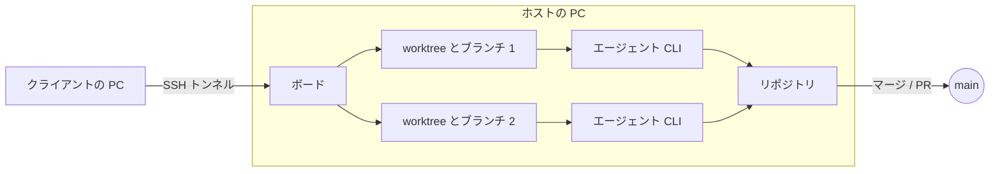
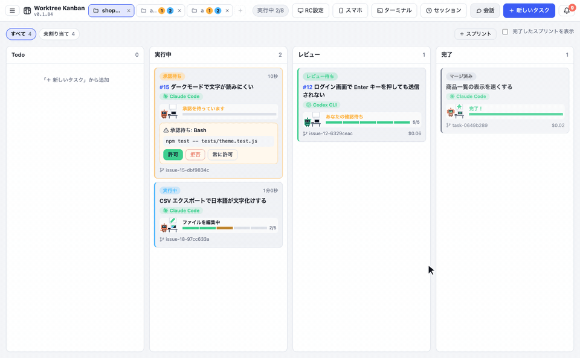

<div align="center">


# Worktree Kanban

<strong>複数の AI エージェントをフローチャートで組み、要所は人が決めるボード。</strong><br />
Codex で実装して Claude でレビューし、直すところがあれば差し戻す。マージするかは人が決めます。

[紹介ページ](https://kazuya83.github.io/worktree-kanban/) · [ダウンロード](https://github.com/kazuya83/worktree-kanban/releases/latest)

[](https://github.com/kazuya83/worktree-kanban/releases/latest)
[](https://github.com/kazuya83/worktree-kanban/releases/latest)
[](docs/images/en/feature-pipeline.gif)
[](https://github.com/kazuya83/worktree-kanban#readme)
[](LICENSE)

[English](README.md) · [日本語](README.ja.md) · [Español](README.es.md) · [Français](README.fr.md) · [简体中文](README.zh-CN.md)

</div>

<div align="center">


</div>

AI コーディングエージェントの CLI（Claude Code / Codex CLI / Antigravity CLI / Gemini CLI / Cursor CLI / OpenCode / Copilot CLI / Amp / Pi / Droid）を、タスクごとに別々の git worktree で並列に動かし、カンバンボードで管理するデスクトップアプリです（Electron、Mac / Windows / Linux）。**1 つのリポジトリの中だけでなく、複数のリポジトリのタスクも同時に動かせます**。


## Worktree Kanban を選ぶ理由

- **エージェントをフローチャートで組む** — 文章で書くか手で描いたフローのとおりに、分岐・ループ・並列をたどりながら、工程ごとにエージェントが作業を引き継ぎます。
- **進み具合がひと目で分かる** — エージェントはピクセルアートのロボットになって、カードの上で働きます。編集中・コマンド実行中・承認待ち・レビュー待ちが動きで分かり、「進捗」タブでは TODO の旗が並ぶ道を進んで、終わるとゴールで跳ねます。
- **最後は人が決める** — マージや PR の前に差分を確かめられます。Claude Code なら、操作の承認もカードで行えます。
- **1 タスクに 1 つの worktree** — タスクごとに別々の git worktree とブランチで動くので、タスク同士や手元の作業ツリーとぶつかりません。
- **複数のリポジトリを同時に** — 最大 3 つのリポジトリをタブで開けます。タブを切り替えても、ほかのタスクは止まりません。
- **いつもの CLI をそのまま** — Claude Code、Codex CLI、Antigravity CLI、Gemini CLI、Cursor CLI、OpenCode、Copilot CLI、Amp、Pi、Droid を、今のログインや設定のまま使えます。
- **Mac と Windows を相互に遠隔操作** — エージェントを動かす PC のボードを、別の PC からそのまま操作できます。承認、質問への回答、追加の指示、マージもできます。
- **手元で完結** — ボードの状態はこの PC に保存します。外部のサーバーは使いません。連携を設定したサービスとは、この PC から直接やりとりします。

## しくみ



- **1 タスク = 1 worktree = 1 ブランチ**。リポジトリの隣の `<repo>.worktrees/<id>` に worktree を作り、`agent/<内容>-<id>` のブランチで作業させます。作業中のタスク同士や、手元の作業ツリーとはぶつかりません
- **エージェントは CLI をそのまま起動します**。Claude Code は `claude -p --input-format stream-json --output-format stream-json` で動かし、出力をログとしてカードに表示します。ログイン・モデル・`CLAUDE.md`・スキルは、ターミナルで使うときと同じものが使われます
- **承認は Claude Code の `--permission-prompt-tool`、Codex の `codex app-server`、Cursor の `cursor-agent acp` で受けます**。権限モードや `--allowedTools`（Worktree Kanban の設定の「許可しておくツール」）で自動で許可されない操作だけが、カードに「承認待ち」として出ます
- **終わったら、マージ（`--no-ff`）か PR / MR の作成（GitHub は `gh`、GitLab は API）で取り込みます**。マージ先のブランチは選べ、マージしたあとに origin へ push することもできます
- ボードの状態は Electron の userData フォルダの `board.json` に保存します。外部のサーバーは使いません

Codex / Antigravity / Gemini / Cursor / OpenCode / Copilot / Amp / Pi / Droid では、CLI の制約から、選択肢の質問・btw・金額の表示が使えません。カードでの承認は Codex と Cursor で使えますが、Antigravity・Gemini・OpenCode・Copilot・Amp・Pi・Droid では使えません（詳しくは [docs/agents.ja.md](docs/agents.ja.md)）。

## 主な機能

### 進捗の見える化: ロボットの動きで、今どこまで進んだかが分かる
エージェントごとに、ピクセルアートのロボットが付きます。ロボットは今の作業を動きで見せるので、ログを読まなくても、どのタスクが何をしていて、どこであなたの手が必要かが、ボードを眺めるだけで分かります。



- **カード**: 机に向かうロボットが、吹き出しで今の作業（ファイルの編集・コマンドの実行・コードの検索・Web の調べものなど）を見せます。承認や返事を待っているときはアンテナが点滅し、TODO の進み具合はマスのバーで出ます。TODO が 1 つ終わるたびに、そのマスから光が飛びます
- **「進捗」タブ**: TODO の旗が並ぶ道を、ロボットが今の TODO まで歩いて進みます。終わった旗は緑ではためきます。レビュー（あなたの確認待ち）ではゴールの手前で待ち、完了するとゴールで跳ねて紙吹雪が舞います。止まってしまったときは、頭の上に雨雲が出ます
- ロボットの色はエージェント（Claude Code・Codex・Gemini など）ごとに違い、カスタムエージェントは設定した色になります
- OS で「視差効果を減らす」（動きを減らす）をオンにしているときは、動かさずに止まった絵で出します

### 別の PC から操作する（RC）
エージェントを動かしている PC（ホスト）のボードを、別の PC（クライアント）の Worktree Kanban から操作できます。Mac と Windows のどちらがホストでも、どちらがクライアントでもかまいません。クライアントでは、承認・質問への回答・追加の指示・マージなどを、ホストの画面と同じように使えます。


- ホストのアプリは `127.0.0.1` だけで待ち受けます。クライアントのアプリが `ssh -N -L` でトンネルを張ってつなぐので、ホストで必要なのは SSH サーバーだけです。外出先からつなぐときは Tailscale などを使います
- SSH は鍵で入ります。クライアントの「RC設定」で ed25519 の鍵（`~/.ssh/agent-kanban_ed25519`）を作り、公開鍵をホストの「RC設定」で登録します
- 初回は、ホストに出る 6 桁のコードでペアリングします。2 回目からは、保存したトークンで、前回の接続先につなぎ直します


手順と、つながらないときの直し方は [docs/remote.ja.md](docs/remote.ja.md) にあります。

### スマホから使う
外出先から、スマホのブラウザ（iPhone の Safari・Android の Chrome）でボードを見て、タスクを作る・追加の指示を送る・承認する・質問に答える、ができます。スマホにアプリを入れる必要はありません。

- PC のアプリが [Cloudflare Tunnel](https://developers.cloudflare.com/cloudflare-one/connections/connect-networks/)（`cloudflared`。無料）を起動して、HTTPS の URL を作ります。ルーターのポート開放は要りません。アカウントなしの Quick Tunnel と、URL が変わらない名前付きトンネルを選べます
- 上部の「スマホ」で「スマホをつなぐ」を押し、出た QR コードをスマホで読み取ってつなぎます。トークンは 30 日で切れ、つないだスマホはいつでも無効にできます
- マージ・PR・設定の変更は、スマホからはできません。エージェントはいつも PC で動き、使えるのは PC のアプリを開いている間だけです

手順と、つながらないときの直し方は [docs/mobile.ja.md](docs/mobile.ja.md) にあります。

このほか、カードの状態（列）のドラッグ&ドロップでの変更、実行中のエージェントへのメッセージ（btw）、画像・ファイルの添付、競争（複数のエージェントに同じタスクを解かせる）、Windows での WSL のリポジトリにも対応しています。使い方は [docs/usage.ja.md](docs/usage.ja.md) にまとめています。

### Pipeline: 文章でフローを組み、それに沿ってタスクを動かす
「Codex で実装して Claude でレビューし、直すところがあれば実装に戻す」のように文章で書くと、エージェントがフローチャートを組み立てます。タスクを作るときにその Pipeline を選ぶと、分岐やループのとおりに、工程ごとにエージェントが作業を引き継ぎます。フローチャートは手で直すこともできます。


くわしくは [docs/agents.ja.md](docs/agents.ja.md) を見てください。

### サブタスク
大きなタスクは、エージェントがサブタスクに分けることを提案します。親のブランチから分けて並列・順番に進め、終わったものから親のブランチにマージします。サブタスクだけ開始することもできます。GitHub・GitLab・Linear・Jira のサブIssue にも対応しています。


### 複数のリポジトリを並列に動かす
リポジトリはタブで開きます（3 つまで）。タブを切り替えても、ほかのリポジトリのタスクは止まらずに動き続けます。開いていないタブには、**動いているタスクの数**（青）と、**承認・質問などであなたの対応を待っているタスクの数**（橙）が出るので、どのリポジトリで手が必要かがタブだけで分かります。同時に動かすタスクの数の上限（設定の「同時に動かす数」）は、すべてのリポジトリで共有します。


タブの「＋」か、開いているタブを押すと、最近開いたリポジトリから選べます。URL からのクローンや、新しいリポジトリの作成もここからできます。

git で管理していないフォルダ（動画づくりなど、コード以外の作業）も開けます。そのときは worktree を作らずにフォルダの中で直接タスクを動かし、終わったら「完了にする」で完了にします（詳しくは [docs/usage.ja.md](docs/usage.ja.md)）。


### 承認
許可が必要な操作は、実行しようとしているコマンドと入力の全文をカードと詳細パネルで確かめてから、許可・拒否・このタスクでは常に許可、のどれかを選べます。拒否するときは、理由をエージェントに返せます。


<details>
<summary>画面を見る</summary>


</details>

### 外部サービスとの連携（GitHub・GitLab・Linear・Jira・Slack）

Issue からタスクを作り、状態を同期できます。Slack には通知を投稿でき、Slack からタスクを始めたり、承認や回答をしたりすることもできます。

| サービス | タスクの元にする入力 | PR / MR の本文 | 状態の同期 | 接続に必要なもの |
| --- | --- | --- | --- | --- |
| GitHub | `21, 22, 24` | `Closes #21` | GitHub Projects の Status | `gh` |
| GitLab | `12`、`group/project#12`、URL | `Closes #12` | ラベルと Issue の開閉 | 接続先の URL、Personal Access Token（`api`） |
| Linear | `ENG-123`、URL | `Ref ENG-123 <URL>` | ワークフローの状態 | API キー |
| Jira | `ABC-123`、URL | `ABC-123 <URL>` | トランジション | 接続先の URL、API トークンとメールアドレス（Cloud）か Personal Access Token（Data Center） |

Issue のタイトル・本文・コメントから指示を作り、1 Issue につき 1 枚のカードを作ります。ブランチ名は `agent/issue-21-…` のようになります。サブIssue は 4 つのサービスすべてで、Issue へのコメントの書き戻しは GitLab・Linear・Jira で使えます。

- **GitLab**: gitlab.com とセルフホストに対応します。origin が接続先の GitLab のものなら、`gh` の代わりに API で MR を作り、マージ・コンフリクト・パイプラインの結果を確かめます
- **Linear・Jira**: 扱うのは課題だけです。PR / MR はリポジトリのホストで作ります。Jira は Cloud と Data Center に対応します
- **Slack**: 完了・失敗・確認待ちを通知します。許可した Slack ユーザーが、対応を書いたチャンネルでメンションか /コマンドを使うと、タスクを始められます。通知のボタンで、承認と質問への回答もできます。初期状態では誰もできません。Socket Mode を使うのでポートの開放は要りませんが、動くのはアプリを開いている間だけです

設定のしかた:

1. 「設定」→「連携」で接続先とトークンを入れて保存します。トークンは OS の安全な保存先の鍵で暗号化します
2. 「設定」→「Issue 連携」の「使う課題管理サービス」で、プロジェクトごとに選びます
3. 「新しいタスク」の Issue のタブに、番号や URL を入れます

Slack アプリの作り方と、サービスごとのくわしい動きは [docs/integrations.ja.md](docs/integrations.ja.md) にあります。


<details>
<summary>画面を見る</summary>


</details>

### エージェントからの質問
Claude Code が `AskUserQuestion` で質問すると、カードが「質問」になり、回答フォームが出ます。複数選択と自由入力（その他）にも対応しています。


<details>
<summary>画面を見る</summary>


</details>

### worktree と差分
「worktree」タブには、ブランチのコミット、未コミットの変更、ベースとの関係、同じリポジトリのほかの worktree が出ます。「差分」タブでは、変わったファイルをフォルダごとのツリーで選んで、ファイルごとに差分を見られます。


<details>
<summary>画面を見る</summary>


</details>

### 会話
「会話」では、タスク（worktree）を作らずに、リポジトリについてエージェントに質問できます。返事は Markdown で表示します。作業させたくなったら「タスクにする」で、その会話の続きとしてタスクにできます。


<details>
<summary>画面を見る</summary>


</details>

### ターミナル

アプリの中でシェルを開けます。タスクの「ターミナル」タブはそのタスクの worktree で開き、上の「ターミナル」ボタン（Ctrl + `）は、タスクと関係なく使えるシェルを画面の下のパネルにいくつでも開きます。タブを切り替えたりパネルを隠したりしても、閉じるまでシェルは動いたままです。遠隔操作中はホストでシェルが動き、許可すればスマホからも使えます。

### 通知
承認待ち・質問・回答待ち・レビュー待ち・完了は、右上のベルのアイコンに通知が溜まり、デスクトップ通知も出ます。通知を押すと、そのタスクが開きます。Slack に投稿することもできます（上の「外部サービスとの連携」）。


<details>
<summary>画面を見る</summary>


</details>

### コンフリクトの解消
マージでコンフリクトが起きると、カードが「コンフリクト」になります。ベースのブランチをタスクのブランチに取り込んだうえで、エージェントに解消させるか、自分でエディタで直すかを選べます。どちらの方法でも、ベースのブランチはマージするまで変わりません。


<details>
<summary>画面を見る</summary>


</details>

### スキルと過去の会話
タスクを作るときに、Claude Code のスキルを 1 つ選べます（`/スキル名` として渡します）。過去の Claude Code の会話（セッション）を選んで、その続きから始めることもできます。


<details>
<summary>画面を見る</summary>


</details>

### タスクスケジューラ

トップバーのメニューから「タスクスケジューラ」に切り替えると、決めた日時（1回だけ・毎時・毎日・毎週・毎月）にタスクを作って動かすスケジュールを、カードで管理できます。カンバンのタスクからそのままスケジュールに登録でき、スケジュールから今すぐタスクを作ることもできます。アプリを起動しているあいだだけ動きます（詳しくは [docs/usage.ja.md](docs/usage.ja.md)）。


## 必要なもの

- git
- 使うエージェントの CLI（Claude Code / Codex CLI / Antigravity CLI / Gemini CLI / Cursor CLI / OpenCode / Copilot CLI / Amp / Pi / Droid のどれか）。ログインを済ませておきます
- GitHub の Issue・PR の機能を使うときは `gh`（アプリから入れることもできます）
- GitLab・Linear・Jira・Slack の連携を使うときは、それぞれのトークン。保存には OS の安全な保存先が必要です（Linux では GNOME Keyring や KWallet など）。GitLab のリポジトリの Issue・MR に `gh` は要りません

## インストール

**Mac / Linux**

```bash
curl -fsSL https://raw.githubusercontent.com/kazuya83/worktree-kanban/main/install.sh | bash
```

**Windows**（PowerShell）

```powershell
irm https://raw.githubusercontent.com/kazuya83/worktree-kanban/main/install.ps1 | iex
```

同じコマンドで、最新版へのアップデートもできます。アプリの「設定」→「アプリの更新」の「新しいバージョンに更新」からも更新でき、「新しい版が出たら自動で更新する」にチェックを付けると、タスクが動いていないときに自動で入れ替えて起動し直します。バージョンの指定・アンインストール・ファイルからのインストール・初回起動の警告は [docs/install.ja.md](docs/install.ja.md) を見てください。

## 使い方

1. 「リポジトリを選ぶ」で、作業させる git リポジトリを選びます（URL からのクローンや、新しく作ることもできます）
2. 「新しいタスク」で指示を書いて作成します
3. 承認待ちになったら、カードで許可します
4. レビュー列に移ったら、差分を確かめて「マージ」か「PR を作成」を押します

## ドキュメント

| ドキュメント | 内容 |
| --- | --- |
| [画面と使い方](docs/usage.ja.md) | 承認・質問・仕様の確認・タスクスケジューラ・スキル・会話・btw・マージ / PR・Issue のステータス・通知・コンフリクトなど、機能ごとの使い方 |
| [エージェントとオーケストレーション](docs/agents.ja.md) | Claude Code / Codex / Antigravity / Gemini / Cursor / OpenCode / Copilot / Amp / Pi / Droid の違い、Pipeline・競争 |
| [設定](docs/settings.ja.md) | トップバーのメニューから開く設定の画面と項目 |
| [連携](docs/integrations.ja.md) | GitLab・Linear・Jira・Slack の設定、できることとできないこと |
| [遠隔操作](docs/remote.ja.md) | 別の PC から SSH トンネルでボードを操作する手順と、つながらないときの直し方 |
| [スマホから使う](docs/mobile.ja.md) | 外からスマホのブラウザでボードを操作する手順（Cloudflare Tunnel）と、つながらないときの直し方 |
| [常駐モード](docs/headless.ja.md) | ウィンドウを開かずに動かし続ける（Linux のサーバーでも）。スケジューラ・Slack・Issue の監視・遠隔操作のホスト |
| [インストール](docs/install.ja.md) | インストール・アップデート・アンインストール、Windows で WSL のリポジトリを使う |
| [開発者向け](docs/development.ja.md) | ソースから動かす・ビルド・リリース・アプリのしくみ・テスト |
| [Vibe Kanban から移る方法](https://kazuya83.github.io/worktree-kanban/migrate-from-vibe-kanban.ja.html) | Vibe Kanban に起きたこと・引き継げるもの・移行の手順 |
| [Conductor から移る方法](https://kazuya83.github.io/worktree-kanban/migrate-from-conductor.ja.html) | Conductor に起きていること・Cloud のデータの書き出し・引き継げるもの・移行の手順 |

## 連絡先

- **GitHub**: [@kazuya83](https://github.com/kazuya83)
- **メール**: [kzy83ishi15@gmail.com](mailto:kzy83ishi15@gmail.com)
- **Issues**: [worktree-kanban/issues](https://github.com/kazuya83/worktree-kanban/issues)（不具合・機能のご要望）

## ライセンス

[Functional Source License 1.1（FSL-1.1-ALv2）](LICENSE) で公開しています。競合する商用の製品・サービスにする場合を除いて、利用・改変・再配布ができます。各版は、公開から2年後に Apache License 2.0 でも使えるようになります。
