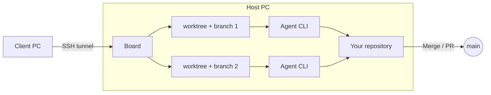
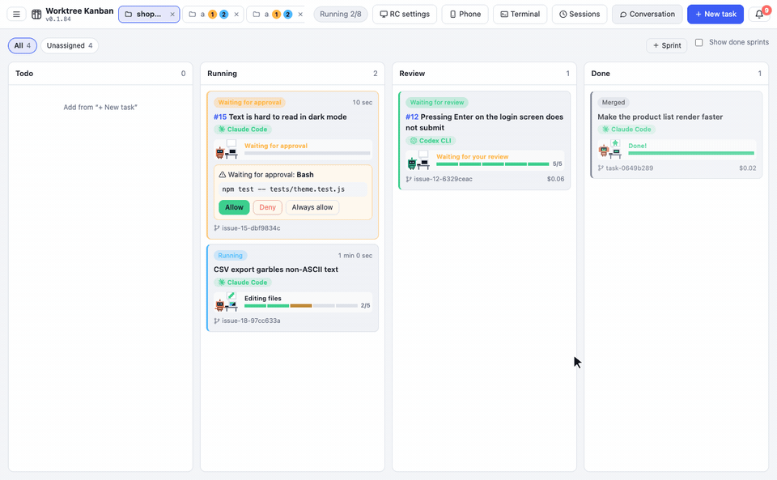

<div align="center">


# Worktree Kanban

<strong>A board for chaining AI coding agents into flowcharts, where people make the key decisions.</strong><br />
Implement with Codex, review with Claude, and send it back if needed. Whether it merges is your call.

[Website](https://kazuya83.github.io/worktree-kanban/) · [Download](https://github.com/kazuya83/worktree-kanban/releases/latest)

[](https://github.com/kazuya83/worktree-kanban/releases/latest)
[](https://github.com/kazuya83/worktree-kanban/releases/latest)
[](docs/images/en/feature-pipeline.gif)
[](https://github.com/kazuya83/worktree-kanban#readme)
[](LICENSE)

[English](README.md) · [日本語](README.ja.md) · [Español](README.es.md) · [Français](README.fr.md) · [简体中文](README.zh-CN.md)

</div>

<div align="center">


</div>

A desktop app (Electron, Mac / Windows / Linux) that runs AI coding-agent CLIs (Claude Code / Codex CLI / Antigravity CLI / Gemini CLI / Cursor CLI / OpenCode / Copilot CLI / Amp / Pi / Droid) in parallel, each task in its own git worktree, and manages them on a kanban board. **It can run tasks from more than one repository at the same time, not only tasks inside a single repository.**


## Why Worktree Kanban?

- **Agents in a flowchart** — describe a flow in plain language or draw it, and agents hand the work over step by step, following branches, loops, and parallel steps.
- **Progress you can see at a glance** — each agent becomes a pixel-art robot that works right on its card. Editing, running commands, waiting for approval, and waiting for review all show as motion, and in the Progress tab the robot walks a road of TODO flags and jumps at the finish line.
- **You stay in charge** — check the diff before you merge or open a PR. With Claude Code, Codex, and Cursor, you also approve actions on the card.
- **One task, one worktree** — each task gets its own git worktree and branch, so tasks never collide with each other or with your working tree.
- **Several repositories at once** — keep up to 3 repositories open as tabs; switching tabs does not stop anything.
- **The CLIs you already use** — Claude Code, Codex CLI, Antigravity CLI, Gemini CLI, Cursor CLI, OpenCode, Copilot CLI, Amp, Pi, and Droid, with the sign-in and settings you have today.
- **Mac ⇄ Windows remote control** — run agents on one PC and operate the same board from the other: approve, answer questions, send instructions, and merge.
- **Local by design** — board state stays on your machine. There is no external server. Services you connect are reached directly from your machine.

## How it works



- **1 task = 1 worktree = 1 branch.** It creates a worktree at `<repo>.worktrees/<id>` next to the repository and works on a branch named `agent/<summary>-<id>`. Tasks do not collide with each other or with the working tree you have open
- **The agent is the CLI, started as-is.** Claude Code runs as `claude -p --input-format stream-json --output-format stream-json`, and its output is shown on the card as the log. Sign-in, model, `CLAUDE.md`, and skills are the same ones you use in the terminal
- **Approval goes through Claude Code's `--permission-prompt-tool`, Codex's `codex app-server`, and ACP for Cursor, Gemini, OpenCode, and Copilot (`cursor-agent acp` and so on).** Only actions that the permission mode or `--allowedTools` (the allowed tools setting in Worktree Kanban) does not auto-allow show up on the card as waiting for approval
- **When it finishes, you bring the work in by merging (`--no-ff`) or opening a PR / MR (`gh` for GitHub, the API for GitLab).** You can choose the target branch, and you can push to origin after the merge
- Board state is stored in `board.json` in Electron's userData folder. There is no external server

Outside Claude Code, the available features depend on the CLI. In-card approval works on Codex, Cursor, Gemini, OpenCode, and Copilot, and multiple-choice questions on Codex and Cursor. btw is passed to Codex without stopping its work, and CLIs over ACP (Cursor, Gemini, OpenCode, Copilot, and Amp or Pi with an adapter) stop the current work and continue with the message. Cost is shown when an ACP CLI reports it. None of these are available on Antigravity or Droid (see [docs/agents.md](docs/agents.md)).

## Features

### Progress at a glance: a robot shows how far each task has come
Each agent gets a pixel-art robot that acts out what it is doing right now. You can tell which task is doing what, and where you are needed, just by looking at the board, without reading any logs.



- **On the card**: the robot sits at a desk, and a speech bubble shows what it is doing (editing files, running a command, searching the code, looking something up on the web, and so on). Its antenna blinks while it waits for your approval or reply, and a segmented bar shows the TODO progress. Each time a TODO is finished, sparks fly from its segment
- **In the Progress tab**: the robot walks along a road of TODO flags to the TODO it is on now. Finished flags wave in green. While the task waits for your review, the robot waits just before the finish line; when the task is done, it jumps at the goal under a shower of confetti. If the run stops, a rain cloud appears over its head
- Each agent (Claude Code, Codex, Gemini, and so on) has its own robot color, and custom agents use the color you set
- When "Reduce motion" is turned on in your OS, the robot is drawn as a still picture

### Operate from another PC (RC)

You can operate the board on the PC that runs the agents (the host) from Worktree Kanban on another PC (the client). Either Mac or Windows can be the host, and either can be the client. On the client you can approve, answer questions, send extra instructions, merge, and so on, the same way as on the host screen.


- The host app listens only on `127.0.0.1`. The client app connects with an `ssh -N -L` tunnel, so the host only needs an SSH server. Use Tailscale or similar when you connect from outside
- SSH uses a key. In the client's "RC settings", create an ed25519 key (`~/.ssh/agent-kanban_ed25519`) and register the public key in the host's "RC settings"
- The first time, you pair with a 6-digit code shown on the host. After that, a saved token reconnects to the previous destination


Steps, and how to fix a connection that fails, are in [docs/remote.md](docs/remote.md).

### Use from your phone
From anywhere, you can see the board in your phone's browser (Safari on iPhone, Chrome on Android), create tasks, send follow-up instructions, approve, and answer questions. Nothing needs to be installed on the phone.

- The app on the PC starts [Cloudflare Tunnel](https://developers.cloudflare.com/cloudflare-one/connections/connect-networks/) (`cloudflared`, free) and creates an HTTPS URL. No port forwarding on your router is needed. Choose a Quick Tunnel with no account, or a named tunnel whose URL stays the same
- Click "Phone" at the top, then "Connect a phone", and scan the QR code with your phone. Tokens expire after 30 days, and you can revoke a connected phone at any time
- Merging, PRs, and settings changes are not available from the phone. Agents always run on the PC, and it works only while the app is open on the PC

Steps, and how to fix a connection that fails, are in [docs/mobile.md](docs/mobile.md).

Also included: drag-and-drop changes to a card's state (column), messages to a running agent (btw), image and file attachments, competition (several agents solving the same task), and WSL repositories on Windows. Usage is summarized in [docs/usage.md](docs/usage.md).

### Pipeline: describe a flow in plain language and run tasks on it
Write the flow you want in plain language, such as "implement with Codex, review with Claude, and go back to implementation if changes are needed", and the agent builds the flowchart. Pick that Pipeline when you create a task, and agents hand the work over step by step, following its branches and loops. You can also edit the flowchart by hand.


See [docs/agents.md](docs/agents.md) for details.

### Subtasks
When a task is large, the agent can propose splitting it into subtasks. They branch from the parent branch, run in parallel or in order, and are merged back as they finish. You can also start a single subtask, and GitHub, GitLab, Linear, and Jira sub-issues are supported.


### Run several repositories in parallel

Repositories open as tabs (up to 3). Switching tabs does not stop tasks in the other repositories. A tab that is not selected shows **how many tasks are running** (blue) and **how many tasks are waiting for you** (approval, a question, and so on, in orange), so you can see which repository needs you from the tabs alone. The limit on how many tasks run at once (the setting for how many to run at once) is shared across every repository.


The "+" on the tab bar, or clicking the open tab, lets you pick from recently opened repositories. You can also clone from a URL or create a new repository from there.

You can open a folder that is not a git repository (video production and other work that is not code). In that case it runs the task directly in the folder without creating a worktree, and you finish it with "Mark done" (see [docs/usage.md](docs/usage.md)).


### Approval

When an action needs permission, you can read the full command and input on the card and in the detail panel, then choose allow, deny, or always allow for this task. When you deny, you can send a reason back to the agent.


<details>
<summary>Screenshot</summary>


</details>

### Integrations (GitHub, GitLab, Linear, Jira, Slack)

Create tasks from Issues and keep their status in sync. You can also post notifications to Slack, and start tasks, approve, and answer from Slack.

| Service | Input for a task | PR / MR body | Status sync | What you need to connect |
| --- | --- | --- | --- | --- |
| GitHub | `21, 22, 24` | `Closes #21` | Status in GitHub Projects | `gh` |
| GitLab | `12`, `group/project#12`, URL | `Closes #12` | Labels and open / closed | URL, Personal Access Token (`api`) |
| Linear | `ENG-123`, URL | `Ref ENG-123 <URL>` | Workflow state | API key |
| Jira | `ABC-123`, URL | `ABC-123 <URL>` | Transition | URL, plus an API token and email (Cloud) or a Personal Access Token (Data Center) |

It builds the instructions from the Issue title, body, and comments, and creates one card per Issue. Branches are named like `agent/issue-21-…`. Sub-issues work with all four services, and comments back to the Issue work with GitLab, Linear, and Jira.

- **GitLab**: works with gitlab.com and self-hosted GitLab. If origin belongs to the connected GitLab, the app uses the API instead of `gh` to create MRs and to check merges, conflicts, and pipeline results
- **Linear and Jira**: these only handle issues. PRs and MRs are created on the repository's host. Jira works with Cloud and Data Center
- **Slack**: posts completions, failures, and items waiting for you. Allowed Slack users can start a task with a mention or a slash command in a listed channel. They can also approve and answer questions with buttons on notifications. Nobody can do any of this by default. It uses Socket Mode, so no port is opened, but it works only while the app is open

To set up:

1. In "Settings" → "Integrations", enter the address and token, then save. Tokens are encrypted with a key from the OS secure storage
2. In "Settings" → "Issue sync", choose "Issue tracker to use" for each project
3. Enter numbers or URLs on the Issue tab of "New task"

How to create the Slack app, and details for each service, are in [docs/integrations.md](docs/integrations.md).


<details>
<summary>Screenshot</summary>


</details>

### Questions from the agent

When Claude Code asks with `AskUserQuestion`, the card becomes a question and an answer form appears. Multiple choice and free text (Other) are both supported.


<details>
<summary>Screenshot</summary>


</details>

### worktree and diff

The "worktree" tab shows the branch commits, uncommitted changes, how the branch relates to the base, and the other worktrees in the same repository. On the "diff" tab you pick changed files in a tree grouped by folder and read the diff file by file.


<details>
<summary>Screenshot</summary>


</details>

### Chat

In "Chat" you can ask the agent about the repository without creating a task (worktree). Replies are shown as Markdown. When you want it to start working, "Make this a task" continues that conversation as a task.


<details>
<summary>Screenshot</summary>


</details>

### Terminal

Open a shell inside the app. The "Terminal" tab of a task opens in that task's worktree, and the "Terminal" button at the top (Ctrl + `) opens a panel at the bottom where you can open as many shells as you like, separate from any task. Shells keep running when you switch tabs or hide the panel, until you close them. During remote control the shell runs on the host, and you can also allow it from your phone.

### Notifications

Waiting for approval, questions, waiting for an answer, waiting for review, and completion collect on the bell icon at the top right, and a desktop notification is shown. Clicking a notification opens that task. They can also go to Slack (see "Integrations" above).


<details>
<summary>Screenshot</summary>


</details>

### Resolving conflicts

If a merge conflicts, the card becomes a conflict. After the base branch is merged into the task branch, you can have the agent resolve it or fix it yourself in an editor. Either way, the base branch stays unchanged until you merge.


<details>
<summary>Screenshot</summary>


</details>

### Skills and past conversations

When you create a task, you can pick one Claude Code skill (it is passed as `/skill-name`). You can also pick a past Claude Code conversation (session) and start from where it left off.


<details>
<summary>Screenshot</summary>


</details>

### Task scheduler

From the menu in the top bar, switch to "Task scheduler" to manage schedules that create and run a task at a set time (once, hourly, daily, weekly, or monthly) as cards. You can register a kanban task as a schedule directly, and you can create a task from a schedule right away. Schedules run only while the app is open (see [docs/usage.md](docs/usage.md)).


## Requirements

- git
- The CLI of the agent you use (one of Claude Code / Codex CLI / Antigravity CLI / Gemini CLI / Cursor CLI / OpenCode / Copilot CLI / Amp / Pi / Droid), already signed in
- `gh`, if you use GitHub Issues and PRs (you can also install it from the app)
- A token for each of GitLab, Linear, Jira, and Slack that you connect. Saving tokens needs OS secure storage (on Linux, GNOME Keyring, KWallet, or similar). Issues and MRs in a GitLab repository do not need `gh`

## Install

**Mac / Linux**

```bash
curl -fsSL https://raw.githubusercontent.com/kazuya83/worktree-kanban/main/install.sh | bash
```

**Windows** (PowerShell)

```powershell
irm https://raw.githubusercontent.com/kazuya83/worktree-kanban/main/install.ps1 | iex
```

The same commands update to the latest version. You can also update from the app: "Settings" → "App update" → "Update to the new version". If you check "Update automatically when a new version is out", it replaces itself and relaunches when no task is running. For pinning a version, uninstalling, installing from a downloaded file, and the first-launch warning, see [docs/install.md](docs/install.md).

## Usage

1. In "Choose a repository", pick the git repository to work in (you can also clone from a URL or create a new one)
2. In "New task", write the instructions and create it
3. When it is waiting for approval, allow it on the card
4. When it moves to the Review column, check the diff and press "Merge" or "Create PR"

## Documentation

| Document | Contents |
| --- | --- |
| [Screen and usage](docs/usage.md) | How to use each feature: approval, questions, spec check, task scheduler, skills, chat, btw, merge / PR, Issue status, notifications, conflicts, and more |
| [Agents and orchestration](docs/agents.md) | Differences between Claude Code / Codex / Antigravity / Gemini / Cursor / OpenCode / Copilot / Amp / Pi / Droid, Pipeline and competition |
| [Settings](docs/settings.md) | The settings screen opened from the top-bar menu, and its items |
| [Integrations](docs/integrations.md) | Setting up GitLab, Linear, Jira, and Slack, and what they can and cannot do |
| [Remote control](docs/remote.md) | How to operate the board from another PC over an SSH tunnel, and how to fix a connection that fails |
| [Use from your phone](docs/mobile.md) | How to operate the board from a phone browser from anywhere (Cloudflare Tunnel), and how to fix a connection that fails |
| [Headless mode](docs/headless.md) | Keep it running without a window (also on a Linux server): the scheduler, Slack, Issue watching, and the remote control host |
| [Install](docs/install.md) | Install, update, uninstall, and using a WSL repository on Windows |
| [For developers](docs/development.md) | Run from source, build, release, how the app is built, and tests |
| [Migrate from Vibe Kanban](https://kazuya83.github.io/worktree-kanban/migrate-from-vibe-kanban.html) | What changed at Vibe Kanban, what carries over, and the migration steps |
| [Migrate from Conductor](https://kazuya83.github.io/worktree-kanban/migrate-from-conductor.html) | What is changing at Conductor, how to export Cloud data, what carries over, and the migration steps |

## Contact

- **Author on GitHub**: [@kazuya83](https://github.com/kazuya83)
- **Email**: [kzy83ishi15@gmail.com](mailto:kzy83ishi15@gmail.com)
- **Issues**: [worktree-kanban/issues](https://github.com/kazuya83/worktree-kanban/issues) — bug reports and feature requests

## License

Released under the [Functional Source License 1.1 (FSL-1.1-ALv2)](LICENSE). You can use, modify, and redistribute it for any purpose except a competing commercial product or service. Each version becomes available under the Apache License 2.0 two years after its release.
