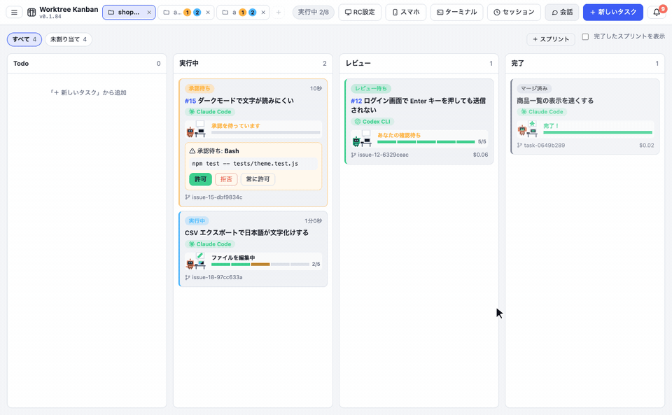

[English](usage.md) · [日本語](usage.ja.md)

# 画面と使い方

それぞれの機能の、詳しい使い方です。エージェントの選び方と Pipeline・競争は [agents.md](agents.ja.md)、設定の項目は [settings.md](settings.ja.md) にあります。

## 複数のリポジトリをタブで行き来する
左上のリポジトリ欄はタブになっていて、リポジトリを **3つまで** 開いておけます。

- タブをクリックすると、そのリポジトリのボードに切り替わります
- 右の「＋」で、新しいタブにリポジトリを開きます（最近開いたもの・フォルダ・クローン・新規作成から選べます）。3つ開いているときは、タブを閉じてから開きます
- 今のタブをもう一度クリックすると、そのタブのリポジトリを別のものに置き換えられます
- タブの「×」で閉じます。閉じたり切り替えたりしても、そのリポジトリで動いているタスクは止まりません。ほかのタブには、動いているタスク（青）と対応を待っているタスク（黄）の数が出ます
- ベースブランチの設定はリポジトリごとに覚えておき、タブを切り替えると戻ります。開いていたタブは、次に起動したときも残っています

## git で管理していないフォルダで使う（動画づくりなど）
コード以外の作業（動画・資料づくりなど）のために、git で管理していないフォルダもそのまま開けます。

- 「リポジトリを選ぶ」で、git リポジトリではないフォルダを選ぶと、git なしのフォルダとして開きます（このパソコンに git が入っていなくても開けます）。遠隔操作のホストのフォルダや WSL のフォルダでも同じです
- 「新しく作る」の「ソース管理」で「git で管理しない」を選ぶと、`git init` をせずに空のフォルダだけを作ります（GitHub には作れません）
- タスクは worktree を作らず、**そのフォルダの中で直接** 動きます。同時に動かす数の上限まで並列に動くので、同じファイルを触るタスクを同時に動かすと変更がぶつかることがあります
- 差分・worktree のタブ、マージ・PR・コンフリクトの解消は出ません。終わったらフォルダの中身を確かめて「完了にする」を押します。「完了にする」は、レビュー列のカード・詳細の上・チャットとログの最後に出ます（質問や仕様の確認に答えている途中は出ません）。「破棄」してもフォルダのファイルは元に戻りません
- 競争（同じタスクを複数のエージェントで解く）は、候補ごとに作業場所を分けられないので使えません。Pipeline は使えます（並列の枝は、同じフォルダで1本ずつ順に動きます）

## ソースを変更しないタスク（SQL を作るだけなど）
MySQL の SQL を作るだけ・調べるだけなど、ソースコードを変えずに終わるタスクも作れます。

- 「新しいタスク」で「**ソースを変更しない（調べもの・SQL などの生成だけ）**」にチェックを付けて作ります。カードには「ソース変更なし」と出ます
- worktree とブランチは作らず、リポジトリのフォルダでそのまま動きます（コードを読んで調べられます）
- エージェントには「ソースを変えないこと」「作ったものは返事にコードブロックで書くこと」を伝えます。Claude Code はファイルを書き換えるツール（Edit / Write など）を止めて動かし、コマンドは設定の権限モードに関係なく毎回カードで確かめます（「計画だけ」ならそれに従います）。Codex / Antigravity / Gemini / Cursor / OpenCode / Copilot / Amp / Pi / Droid は、読み取りだけの計画モードで動かします
- 作った SQL などは「チャット」タブの返事に出ます。確かめたら「完了にする」を押します（git で管理していないフォルダのタスクと同じです）。差分・マージ・PR は出ません
- 競争と、並列のある Pipeline は使えません。サブタスクにも分けられません

## カードの列をドラッグで動かす
ボードのカードは、ドラッグ&ドロップで列（状態）を変えられます。マージや PR を待たずに、状態だけを変えられます。

- Todo → 実行中: タスクを開始します
- レビュー → 完了: マージせずに完了にします（worktree とブランチは残すので、あとで戻して続けられます。Issue の Projects の Status は Done になります）
- 完了 → レビュー: 完了にしたタスクを戻します（マージ・PR で worktree を片付けたタスクは戻せないので、「修正タスクを作る」を使います）
- 実行中のタスク・会話・サブタスクが残っている親のタスクは動かせません。マージや PR のマージで完了になるのは、これまでどおりです

詳細の上の「完了にする」でも、マージや PR を作らずに完了にできます（ソースを変える前提で作ったが、変える必要がなかったときなど）。worktree の差分（コミット済み・未コミット・未追跡のファイル）がなければ worktree とブランチを片付け、差分があればドラッグと同じく残します。

## カード上で承認する
承認待ちのカードは黄色く光ります。実行しようとしているコマンドを確かめて、その場で「許可 / 拒否 / 常に許可」を押せます。

## 詳細パネル（承認待ち）
カードをクリックすると開きます。入力の全文を確かめたり、拒否の理由を書いて Claude に伝えたりできます。ログはリアルタイムに流れます。

## worktree のスクリプト（セットアップ・片付け・実行）

設定の「ブランチと取り込み」に、プロジェクトごとに3つのスクリプトを書けます。設定はこのマシンにだけ保存し、リポジトリには入りません。どれも worktree のフォルダで動き、空欄なら何もしません。

- **セットアップ**: worktree を作った直後、エージェントを始める前に動きます（`npm install` や `.env` のコピーなど）。失敗するとエージェントは始めず、タスクはエラーになります。直してやり直すと、もう一度セットアップから動きます。動いているあいだは「停止」で止められます
- **片付け**: マージ・PR・破棄で worktree を消す直前に動きます。失敗しても、5分たっても終わらなくても、ログに警告を残して worktree は消します
- **実行**: 開発サーバーなど、手で確かめるためのコマンドです。自動では動きません

詳細の「worktree」タブのボタンで、実行スクリプトを動かす・止めることができ、セットアップと片付けも手で動かせます（片付けを手で動かしても worktree は消しません）。出力もそこに出ます。1つのタスクで同時に動かせるスクリプトは1つです。実行スクリプトは、worktree を消すときとアプリを終了するときに止まります。

スクリプトは macOS・Linux・WSL では sh / bash で動き、途中の行が失敗するとそこで止まります。Windows では各行を `&&` でつないで cmd で動かします。次の環境変数が使えます。

| 環境変数 | 内容 |
| --- | --- |
| `WORKTREE_KANBAN_ROOT` | リポジトリのフォルダ（例: `cp "$WORKTREE_KANBAN_ROOT/.env" .`） |
| `WORKTREE_KANBAN_WORKTREE` | このタスクの worktree のフォルダ |
| `WORKTREE_KANBAN_BRANCH` | このタスクのブランチ |
| `WORKTREE_KANBAN_BASE_BRANCH` | ベースブランチ |
| `WORKTREE_KANBAN_TASK_ID` | タスクの ID |
| `WORKTREE_KANBAN_PORT` | このタスクのポート（下の「タスクごとのポート」） |
| `WORKTREE_KANBAN_PORT_COUNT` | このタスクで使えるポートの数 |
| `PORT` | `WORKTREE_KANBAN_PORT` と同じ番号 |

### タスクごとのポート

worktree はファイルを分けるだけなので、同じ開発サーバーを並列で動かすと、そのままではポートがぶつかります。そこで worktree を作るときに、タスクごとに連続する10個のポートを 20000〜29999 から割り当てます（`WORKTREE_KANBAN_PORT` から +9 まで）。探し始める番号と数は、設定の「ブランチと取り込み」でプロジェクトごとに変えられます（リポジトリの `.worktree-kanban/settings.json` でチームと共有もできます。[設定](settings.ja.md#チームで共有)）。ほかのアプリが使っているポートは避けます。番号はアプリを再起動しても変わらず、worktree を消すと空きに戻ります。今の番号は詳細の「worktree」タブに出ます。

スクリプトだけでなくエージェントにも同じ環境変数を渡すので、エージェントが動かす開発サーバーも、`PORT` を見るものならぶつかりません。`PORT` を見るサーバー（Next.js や Express など）はそのまま動きます。見ないサーバーは、実行スクリプトで番号を渡します。

```sh
# Vite（2つ目のサーバーは +1 を使う）
npm run dev -- --port "$WORKTREE_KANBAN_PORT" --strictPort &
API_PORT=$((WORKTREE_KANBAN_PORT + 1)) npm run api
```

Windows の cmd では `%WORKTREE_KANBAN_PORT%` と書きます。

### 内蔵ブラウザとデザインモード

詳細の「ブラウザ」タブで、そのタスクの開発サーバー（`http://localhost:<WORKTREE_KANBAN_PORT>/`）をアプリの中で開けます。実行スクリプトを設定していれば、タブの「実行スクリプトで開発サーバーを起動」から起動でき、サーバーが立ち上がるまで数秒ごとに読み込み直します。アドレス欄には URL のほか、ポート番号だけ（`3001` など）も入れられます。ログインなどの状態は、アプリを再起動しても残ります。

アドレス欄の上のタブの右にある「+」で新しいタブを開き、いくつものページを並べて開けます（1つのタスクで10個まで）。新しいタブは、そのタスクの開発サーバーを開き、アドレス欄を選んだ状態になるので、そのまま別の URL も打てます。タブは × か真ん中のボタンのクリックで閉じます。開いていたタブは、アプリを開いているあいだはタスクごとに覚えていて、別のタスクから戻ると同じタブで開き直します。デザインモードとペンは、見ているタブのページで使えます。

「デザインモード」を押してから画面の部品をクリックすると、その部品の HTML・当たっている CSS のルール・計算されたスタイルと、スクリーンショットを集めます（クリックはページには渡しません。Esc でやめます）。部品は5個まで選べます。どうしたいかを書いて送ると、レビュー待ち・失敗・完了のタスクには、スクリーンショットを添付して追加の指示として送ります。実行中のタスクには btw として送ります（このときスクリーンショットは送れず、HTML と CSS だけです）。

「ペン」を押すと、画面をドラッグして線で囲めます。囲んだところを、赤い線ごと写したスクリーンショットと、囲みの中にある部品の HTML として集めます（「このあたりの余白を詰めて」のように、部品をまたぐ範囲に指示を出したいときに使います）。囲みは部品と合わせて5個まで、「デザインモード」と「ペン」は押すたびに切り替わります。

遠隔操作で接続先のタスクを見ているときは、開発サーバーが接続先のマシンで動いているので、内蔵ブラウザでは開けません。

## 詳細パネル（差分・マージ）
レビュー列のカードでは、ベースブランチからの差分を見てからマージできます。マージ先は、好きなブランチを選べます（新しく作ることもできます）。

## エージェントからの質問に答える
選択肢の質問は、その場で選んで答えられます（複数選択・その他の自由入力にも対応）。

文章で質問されたときは「回答待ち」になり、下の欄から答えられます。


## 内容が詰まっていないタスクは、対話で仕様を詰める
新しいタスク（手で書いたもの・Issue から作ったもの）を始めると、エージェントはまず指示とリポジトリを読んで、開発を始められるくらい仕様が詰まっているかを判断します。

- 詰まっていれば、そのまま開発を始めます
- 詰まっていなければ、ファイルを変えずに止まり、カードが水色の「**仕様の確認**」になって「内容が詰まっていないので、開発を開始できません」と表示されます（🔔 とデスクトップ通知も出ます）。詳細画面にエージェントの質問が出るので、下の欄から答えます
- 答えるたびにエージェントがもう一度判断し、まだ足りなければ続きの質問をします。詰まったら「決まった仕様」をまとめてから、同じ会話の続きで開発を始めます
- 仕様の確認中は、Issue の Projects の Status をレビューにしません（In progress のまま）
- 設定の「新しいタスクの内容が詰まっていなければ、開発を始める前にエージェントと対話して仕様を詰める」で切れます

## 決めた日時にタスクを動かす（タスクスケジューラ）

トップバーの左端のメニューボタン（三本線）を押すと、「カンバン管理」「タスクスケジューラ」「設定」を切り替えられます。カンバン管理はこれまでのボードです。設定は [settings.md](settings.ja.md) を見てください。

タスクスケジューラには、今開いているリポジトリのスケジュールがカードで並びます。カードにはタスク名と最終実行日（まだ動いていなければ「未実行」）が出ます。カードを開くと、繰り返しの設定、次回の実行日時、指示内容、エージェント、スキル、実行履歴が見られます。履歴の「カードを開く」で、そのとき作ったカンバンのカードへ移動できます。

**登録のしかた**は2つあります。

- タスクスケジューラの「新しいスケジュール」から、新しく登録する
- カンバンのタスク詳細の「スケジュール登録」から、そのタスクの内容（タイトル・指示・スキル・エージェント・モデル）をコピーして登録する。Pipeline・競争・カスタムエージェントの指定も引き継ぎます。添付ファイルはコピーしません。元の Pipeline などがなくなっていて選べないときは、編集画面に注意が出ます

**繰り返し**は、1回だけ、N分おき（1〜1440分）、毎時、毎日、毎週（曜日は複数選べます）、毎月から選びます。時刻はアプリを動かしている PC のローカル時刻です。毎月で 31 日のように、その月にない日を選ぶと、その月の末日に実行します。

**カードを開いてできること:**

| ボタン | 動き |
|---|---|
| 今すぐ実行 | カンバンにタスクを作って、すぐに開始します。次回の予定は変わりません |
| タスクだけ作成 | カンバンにタスクを作ります。開始はしません。そのカードが Todo に残っているあいだ、次の定期実行は見送られます |
| 編集 | 指示や繰り返しなどを変えます |
| 停止 / 再開 | 止めているあいだは実行しません。実行済みの「1回だけ」は、「編集」で日時を変えてから再開してください |
| 削除 | スケジュールを消します。作成済みのタスクは残ります |

時刻になると、ふつうのカードを作って開始します。そのあとの承認、同時に動かす数、レビューは手で作ったタスクと同じです。人が見ていなくても止まらないよう、仕様の確認は行いません。

**動くのはアプリの起動中だけ**です（OS のスケジューラは使いません）。タブで開いていないリポジトリのスケジュールも動きます。遠隔操作のときは、ホストのアプリで動きます。

人が見ていないところで動くので、次のときは実行しません。結果は実行履歴に残ります。

| 場面 | 動き |
|---|---|
| 予定から10分より遅れた（アプリを閉じていた・スリープしていた） | 見送って次回へ進みます。「時刻を過ぎていたら、起動後に1回だけ追いつく」にチェックを付けたスケジュールだけ、1回実行します |
| 前回のカードが Todo・待機中・実行中のまま | 今回は見送ります（同じタスクを積み上げません） |
| Pipeline が消されたなどで実行できない | 失敗として記録して通知し、次回へ進みます。通知を押すとタスクスケジューラが開きます |
| リポジトリのフォルダがなくなった | 失敗として記録して通知し、スケジュールを止めます。フォルダが戻ったら、そのリポジトリを開いて「再開」できます |

### 新しい Issue ごとにカードを作る（Issue の監視）

スケジュールの「種類」で「Issue の監視」を選ぶと、繰り返しの時刻ごとに GitHub の開いている Issue を確認し、新しい Issue 1件につきカードを1枚作ります。確認の間隔は「繰り返し」で決めます（「N分おき」のほか、毎時や毎日なども選べます）。`gh` を使います。`gh` がないときは GitHub の API で読みます（public リポジトリのみ）。

| 設定 | 内容 |
|---|---|
| 対象のラベル | カンマ区切りで指定すると、全部付いている Issue だけを対象にします。空なら絞りません |
| 対象の作成者 | その人が作った Issue だけを対象にします。`@me` は `gh` のログインユーザーです。空なら絞りません |
| 作ったカードの扱い | 「Todo に置くだけ」か「自動で開始する」を選びます |
| 追加の指示 | 省略できます。Issue の内容に加えてエージェントに伝えます |

- **対象になる Issue**: 登録の時点ですでにある Issue は対象にしません。登録のあとに作られた Issue だけをカードにします（作られたあとで対象のラベルが付いた Issue も含みます）
- **カードは1回だけ**: 一度カードにした Issue、すでにカードがある Issue からは作りません。カードを消しても作り直しません
- **一度に作る枚数**: 1回の確認で作るカードは 10 枚までで、残りは次回に古い順で作ります
- **仕様の確認**: 「Todo に置くだけ」のカードは、開始すると通常のタスクと同じように仕様を確認します。「自動で開始する」カードは確認しません
- **遅れたとき**: アプリを閉じていたあいだや、スケジュールを止めていたあいだに作られた Issue も、次の確認で拾います
- **実行履歴**: カードを作ったときと失敗したときだけ残します。新しい Issue がない確認は残さず、詳細の「最終確認」の日時だけが変わります。読み取りの失敗が続いても、通知は最初の1回だけです
- **今すぐ確認**: 詳細の「今すぐ確認」で、次回を待たずに確かめられます。カードの扱いはスケジュールの設定に従います

> Issue の本文とコメントは、そのままエージェントへの指示になります。public リポジトリでは誰でも書けるので、「自動で開始する」を選ぶときは、ラベルや作成者で対象を絞ってください。ラベルを付けられるのは書き込み権限のある人だけです。また、プロジェクトの権限モードが「すべて自動で許可する」でも、Issue から作ったタスクは「ファイル編集は自動・コマンドは承認」（`acceptEdits`）で動きます。悪意のある Issue から承認なしでコマンドが動くことはありません。

## サブタスクに分けて進める
大きなタスクは、いくつかのサブタスクに分けて、別々のエージェントに並列・順番に進めてもらえます。

- **しくみ**: 親のタスクのブランチを1本作り、サブタスクはそのブランチから分けた worktree・ブランチで動きます。サブタスクが終わったら親のブランチにマージし、すべてのサブタスクが「完了」になったら、親のエージェントが全体の仕上げ（つなぎ目の確認・テスト）をしてからレビューに回します（マージしたものが1つもなければ、仕上げはせずにそのままです）。レビュー・マージ・PR は親のタスクで行います
- **直列か並列か**: サブタスクごとに「先に終わっている必要があるサブタスク」をエージェントが内容を見て決めます。自動で進めるときは、先のサブタスクがマージされたら、そのあとのサブタスクが親のブランチ（先の変更が入ったもの）から始まります。この順番は目安で、サブタスクだけ開始するとき（下）は止めません
- **サブタスクだけ開始する**: 「サブタスク」タブの「開始」ボタン（または「作業中」の列へドラッグ）で、ほかのサブタスクを動かさずに、そのサブタスクだけを始められます。親が開始前なら、親のブランチだけを作り、親のエージェントは動かしません（順番も決めません）。個別に開始したサブタスクは、終わるとレビューで止まるので、差分を見てから「取り込む」で親のブランチにマージします。残りをまとめて動かしたいときは「残りを自動で進める」を押します
- **状態はドラッグ&ドロップで変える**: 「サブタスク」タブでは、サブタスクが「未着手 / 作業中 / レビュー / 完了」の列に並び、ドラッグで状態を変えられます。マージは状態を変えるきっかけにしません（個別に開始したものは、取り込んだあともレビューの列に残るので、完了へ動かします）
  - 未着手 → 作業中: そのサブタスクだけ開始 / 未着手 → 完了: 始めずに完了にする
  - レビュー → 完了: 取り込んだものは完了に。まだ取り込んでいないものは、取り込まずに完了にします（そのサブタスクの worktree とブランチは消えます）
  - 完了・取り込み済み → 未着手: やり直す（前にマージした変更は親のブランチに残ります） / 完了 → レビュー: 取り込んだものを戻す
  - 作業中のサブタスクと、親が動いているあいだは動かせません
- **エージェントからの提案**: 仕様の確認（上）のときに、分けたほうがよい大きなタスクだとエージェントが判断すると、カードが「**サブタスクの提案**」になります。「チャット」タブの最後で、サブタスクの名前・指示を直してから「サブタスクでやる」か「分けずに進める」を選びます。Issue から作ったタスクなら、サービスにもサブIssue を作って親の Issue にぶら下げることも選べます（確認してから作ります）
- **手動で決める**: 開始前のタスクの「進捗」タブの「サブタスクを編集」で、サブタスクを足せます。足したあとは「サブタスク」タブで直せます（順番は、開始したときにエージェントが決めます）
- **サブIssue**: Issue から作るとき、その Issue に開いているサブIssue がぶら下がっていれば、それぞれをサブタスクにします。PR / MR の本文には、親の Issue と、マージしたサブIssue の行が入ります（GitHub なら `Closes #…`）。GitHub・GitLab・Linear・Jira で使えます（[integrations.md](integrations.ja.md)）
- **マージの仕方**: 「終わったら自動で親のブランチにマージする」か「確かめてからマージする」を、開始前（サブタスクの編集欄・提案のフォーム）に選べます。確かめるときは、サブタスクが終わると「確認待ち」になるので、差分を見てから「取り込む」を押します。既定はメニューの設定の「タスクの既定」で変えられます
- **コンフリクト**: サブタスク同士の変更がぶつかったら、親のエージェントが自動で解消して先へ進みます（解消しきれなかったときは、ふだんのコンフリクトと同じく「コンフリクト」の欄から頼み直すか、自分で直します）
- **進み具合**: ボードには親のカードだけが出て、「サブタスク 2/4 完了」とサブタスクの数だけ区切ったバーで進み具合が分かります。サブタスクを動かしているあいだ、親は「実行中」の列に出ます。詳細の「進捗」タブには、全体の進み具合（完了の割合・完了 / 作業中 / 未着手の数・今動いているサブタスク・親のタスクとサブタスクを合わせたコスト）が出ます。サブタスクがあるタスクには「サブタスク」タブが出て、サブタスクごとの状態・担当・金額・マージしたものの報告を見られます。「サブタスク」タブのカードをクリックすると、そのサブタスクの詳細をモーダルで開きます。動いている（作業中・レビューの）サブタスクは、タスクの詳細と同じもの（チャット・ログ・差分・進捗と TODO・質問への回答・追加指示）で、閉じると親のタスクの「サブタスク」タブに戻ります。まだ始めていない・終わったサブタスクは、やること・報告・マージしたかを見られます（未着手なら、そこから開始もできます。「編集」で名前とやることを変えられ、開始するとその内容でサブタスクが動きます）
- Pipeline・競争・git で管理していないフォルダのタスクは、サブタスクに分けられません
- Pipeline の並列で自動で作られた枝のカードには、ボード上で「サブタスク」のラベルが付きます（工程の名前に「サブタスク」がなくても付きます）

## スキルを選ぶ
「⚡ スキルを選ぶ」を押すと、使えるスキルがカードで並びます。1つだけ選べます。選んだスキルは、入力欄の上にラベルで出ます。


## 指示にファイルを添付する
「新しいタスク」と「会話」（始めるときと、続きのメッセージ）の入力欄、タスクの詳細の下の追加の指示の入力欄（質問への返事・完了したタスクについての会話も）、開始する前のタスクの「進捗」タブの編集欄には、画像・PDF・テキストなどのファイルを添付できます。

- 付け方は3つあります: 入力欄への **貼り付け**（⌘V / Ctrl+V。スクリーンショットもそのまま貼れます）、**ドラッグ＆ドロップ**、入力欄の下の「ファイルを添付」ボタン
- 付けたファイルは入力欄の下に並びます（× で外せます）。10 個まで、合わせて 20MB まで付けられます
- 添付は、作業フォルダ（worktree・リポジトリ）の外にあるアプリのフォルダに保存します。指示の最後には保存した場所を書き足すので、どのエージェントもそこから読めます
  - Claude Code には、画像（PNG / JPEG / GIF / WebP、3.5MB まで）をメッセージにそのまま付けて渡します
  - Codex / Antigravity / Gemini / Cursor / OpenCode / Copilot / Amp / Pi / Droid と、画像以外のファイルは、保存した場所を見て読んでもらいます
- 遠隔操作のクライアントから付けたファイルは、ホストに送ってホストに保存します
- 付けた画像とファイルの名前は、ログの「あなたの指示」に出ます。開始する前のタスクでは、「進捗」タブの編集欄にも出て、× で外したり新しく足したりできます（「保存」で反映します）。タスクを破棄すると、添付も消します

## Issue から作成
「＋ 新しいタスク」を押し、上のタブで「GitHub Issue から作成」を選んで、Issue 番号と会話（セッション）を選びます。複数の番号を入れると、それぞれ1枚のカードになって並列で動きます。タブの名前には、「Issue 連携」で選んだサービスが出ます（GitLab・Linear・Jira は [integrations.md](integrations.ja.md)）。

## コンフリクトを解消する
マージでコンフリクトが起きたら、エージェントに解消してもらうか、自分で直すかを選べます。PR を作ったあとでマージ先が進んで PR がコンフリクトしたときも、同じようにアプリの中で解消して PR を更新できます。

## タスクを作らずにエージェントと話す（💬 会話）
上部の「💬 会話」を押すと、タスクに紐づかない会話を始められます（このリポジトリについての質問・調べもの・相談など）。話すエージェントは、使う設定のものから選べます。会話はボードの列には並ばず、「💬 会話」ボタンから一覧を開けます（ボタンの数字は会話の数。返事を待っている会話があると黄色で件数を出します）。会話を選ぶと画面の中央にモーダルで開き、下の欄から続きを話せます。

ログのエージェントの返事やあなたの指示は Markdown として整えて表示します（見出し・リスト・表・コードブロックなど）。

- worktree やブランチは作らず、リポジトリのフォルダでそのまま動きます。コミット・マージ・PR はしません
- 手元の作業中のファイルで動くので、ファイルの変更やコマンドは毎回カードで確かめます（設定の権限モードが「計画だけ」「すべて自動で許可」のときはそれに従います）
- 同時実行数の上限には数えないので、タスクが詰まっていてもすぐに返事が来ます
- 作業してほしくなったら「📝 タスクにする」を押すと、会話の続きとして worktree で動くタスクを作れます（会話そのものはそのまま残ります）。Claude Code どうしなら会話そのものを引き継ぎ、それ以外（Codex / Antigravity / Gemini / Cursor / OpenCode / Copilot / Amp / Pi / Droid の会話や、別のエージェントのタスク）は会話のやりとりを最初の指示に添えて渡します

## 会話（セッション）を切り替える
詳細画面の「会話」で、次の実行にどの会話を使うかを選べます。既存の会話から引き継いだときは、どこから引き継いだかが表示されます。

## 進捗を見る
詳細の「進捗」タブで、タスクが今どこまで進んでいるかを見られます。



- 状態・開始した時刻と経過時間・エージェント・コスト
- エージェントのロボット（ピクセルアート）が、TODO の旗が並ぶ道を今の TODO まで歩いて進みます。吹き出しで今の作業（編集・コマンド・検索など）を見せ、承認や返事を待っているときは手を挙げ、レビュー待ちではゴールの手前で待ち、完了するとゴールで跳ねます。ボードのカードにも、同じロボットが机で作業する様子と TODO のマスのバーが出ます（OS で動きを減らす設定にしているときは止まった絵で出ます）
- エージェントが作った TODO（Claude Code の TodoWrite、Codex・Gemini・Cursor の TODO リスト。Antigravity は TODO を出さないので、この一覧は空のままです）を、完了・作業中・これからに分けて、完了した割合のバーと一緒に出します。Pipelineでは今の工程の TODO を、並列の枝を待っているあいだは枝ごとの TODO を出します
- Pipelineでは、設定のフローチャートをそのまま描き、終わった工程（緑）・今動いている工程（青）・止まっている工程（橙）・これからの工程を色分けします。通った線は緑、今の工程へ向かう線は青で動きます。フローチャートは右上のボタンか、⌘（Ctrl）＋スクロール・ピンチで拡大・縮小できます（「全体」で枠の幅に収めます）。その下に、工程ごとの時間・金額・判定・次の工程へ渡した報告が出ます。レビューや失敗で止まっているときは、工程の「ここからやり直す」で、その工程の最初の回の直前へ戻せます（[途中の状態に戻す](#途中の状態に戻す)）
- 最近の作業（ツールの呼び出し・返事）を新しい順に出します。くわしくは「ログ」で見られます
- 開始する前のタスクでは、ここでタイトルと最初の指示を編集できます（開始したあとの指示は「チャット」の上で見られます）

競争のタスクでは、候補の一覧と「採用」「比べてもらう」もここに出ます。サブタスクのタスクでは、親のタスクとマージのしかたが出ます。サブタスクに分けたタスクでは全体の進み具合が出て、サブタスクごとの状態と操作は「サブタスク」タブに出ます。

## 途中の状態に戻す
カードを列のあいだで動かす「戻す」（完了からレビューへ）とは別です。ここでは、作業そのものを、記録した時点まで戻します。

戻せるのは **Pipeline の工程** と **エージェントが動いた回** の両方で、どちらも同じ操作です。時点は、その回が始まる直前です。工程の「ここからやり直す」は、その工程の最初の回の直前へ戻します。戻したあとは、そのときの指示をもう一度送って、すぐに動き始めます。

戻るのは **ファイル**、**Pipeline の進み具合**、**会話** です。戻す時点よりあとの変更は残さず捨てます。戻した操作は取り消せません。それまでに使った金額は戻りません。その時点以降のログは消え、戻した時点とそれよりあとの履歴も消えます（動き始めると、新しく記録されます）。`node_modules` など、git が無視しているファイルは残ります。手で直した未コミットの変更は、次にエージェントが動く直前の時点に含まれます。

時点は、エージェントを起動する直前に1件ずつ記録します（古い順で最大100件。それを超えると古いものから消えます）。次の実行は記録しません。

- 完了したあとの会話
- コンフリクトを解消するための実行
- 中断したタスクの再開
- git で管理していないフォルダのタスク

### どこから戻すか
- 詳細のワークフローでは、その工程の最初の実行があるときに「ここからやり直す」が出ます
- 「進捗」タブの「履歴」には、各回が新しい順に並び、「ここに戻す」でその回の直前へ戻ります
- 確認のダイアログには「あとの変更は捨てられ、元に戻せません」と「すぐに動き始めます」と出ます
- 戻せないときは、ボタンは無効になり、理由が出ます

### 戻せないとき
次のときは戻せません。ファイルを戻す途中で失敗したときは、カードは変えずにエラーになります（記録したファイルの時点がないときも同じです）。

- レビューと失敗以外の状態（実行中・待機中・完了など）
- 並列の枝の完了を待っている、またはコンフリクトがある
- 開始したサブタスクを持っている
- 完了済み、マージ済み、または worktree がない
- PR を作ってある
- 並列の枝で、親のタスクがすでにマージした
- git で管理していないフォルダ（ファイルを戻せないため）

並列の枝の工程は、合流したあとは親のタスクから戻せません（枝のカードは片付いているため）。親の時点だけが表示されます。

### 会話の扱い
会話の戻し方は、エージェントで違います。

- その時点の会話がないとき: 新しい会話で始めます。Pipeline の工程の最初の回は、いつもこれです
- 別の会話を引き継ぐ直前だったとき: 引き継いだ元の会話は変えません。どの会話を使うかだけを、その時点に戻します
- Claude Code: ほかのカードがその会話を使っておらず、会話のファイルがその時点の大きさ以上で、区切りが行の境目なら、ファイルをその大きさに切り詰めて、同じ会話の続きから始めます。条件に合わなければ、次の扱いと同じく新しい会話にします
- Codex / Antigravity / Gemini / Cursor / OpenCode / Copilot / Amp / Pi / Droid（条件に合わなかった Claude Code も含む）: 新しい会話で始め、ログの指示と返事から作った引き継ぎ文（8,000字まで）を、指示の前に付けます

## ターミナル（自分でコマンドを打つ）

アプリの中でシェルを開いて、自分でコマンドを打てます。エージェントはこれまでどおり裏で動き、ターミナルはそれとは別のシェルです。

- **タスクのターミナル**: タスクの詳細の「ターミナル」タブで、そのタスクの worktree でシェルを開きます（タスクごとに1つ）。git のタスクは、開始して worktree ができてから開けます。git で管理していないフォルダのタスクと会話は、そのフォルダで開きます
- **ターミナルのパネル**: 上の「ターミナル」ボタン（または Ctrl + `）で、画面の下にパネルを開きます。「＋」で今のリポジトリのフォルダ（無ければホーム）に新しいシェルを開き、いくつでも開けます。「このタスク」で、開いているタスクのターミナルをパネルに出します。上の線をドラッグすると高さを変えられます
- 1つのターミナルは、同時には1か所にだけ出せます。パネルに出したときは、タスクのタブに「ここに表示」が出て、押すと戻せます
- タブを切り替えても、タスクの詳細を閉じても、パネルを隠しても、シェルは動いたままです。パネルのタブの「×」でシェルを終わらせます。タスクを削除したとき、アプリを終えたときも終わります
- シェルは、Mac と Linux はログインシェル（`$SHELL`）、Windows は PowerShell 7（`pwsh`。入っていなければ Windows PowerShell）です。WSL の中のリポジトリでは、その distro のシェルで開きます
- コピーは ⌘C（Windows と Linux は、選んでいるときの Ctrl+C か Ctrl+Shift+C）、貼り付けは ⌘V / Ctrl+V です
- そのパソコンでアプリの中のターミナルを起動できないとき（同梱の node-pty も python3 も使えないとき）は、「外部のターミナルで開く」で、OS のターミナルを同じフォルダで開きます
- 遠隔操作中は、ホストのタブで開いたターミナルはホストで動きます。パネルには、ホストとこのマシンの両方のターミナルが並びます。スマホからは、許可したときだけ使えます（[スマホから使う](mobile.ja.md)）

## btw（実行中にメッセージを送る）
実行中のカードの「btw」タブから、作業を止めずに Claude へメッセージを送れます。受け取られると「反映済み」になります。Codex（app-server で動くとき）も作業を止めずに受け取ります。Cursor・Gemini・OpenCode・Copilot CLI など ACP で動く CLI は、今の作業を止めて、メッセージを足した指示で続けます（くわしくは [エージェント](agents.ja.md)）。


## マージ先を選ぶ
「マージ…」を押すと、マージ先のブランチを選べます。新しいブランチを作ったり、マージしたあともタスクを続けたりもできます。


## 直接マージか PR 作成かを選ぶ
設定の「レビュー後の取り込み方」で、**PR を作成する**（origin に push して `gh pr create`。初期値）か **直接マージする**（ローカルで `git merge`）かを、プロジェクトごとに選べます。初めて開いたプロジェクトは「PR を作成する」から始まります（origin がない・GitHub でも連携した GitLab でもないリポジトリと、git で管理していないフォルダは「直接マージする」から）。PR にすると、レビュー中のカードのボタンが「PR を作成…」になり、base ブランチ・タイトル・本文を決めて PR を作れます（Issue から作ったタスクには `Closes #番号` が入ります）。追加指示で直したあとにもう一度押すと、同じ PR に push して更新します。PR の作成には gh のインストールとログインが必要です。origin が連携した GitLab のものなら、`gh` の代わりに API で MR を作ります（[integrations.md](integrations.ja.md#gitlab)）。

作った PR は、アプリが1分ごとに GitHub で状態を確かめます。**PR がマージされると、タスクは自動で「完了」になります**（worktree とローカルのブランチも片付けます）。ただし worktree に PR に入っていない変更（未コミットの変更や、push していないコミット）が残っているときは、消さずにレビュー中のまま残します。

## Issue のステータスを自動で変える
Issue から作ったタスクは、カードの列に合わせて、Issue が入っている **GitHub Projects の Status** を自動で変えます。GitLab・Linear・Jira の Issue も同じ列に合わせて変えます。変わるものはサービスごとに違います（[integrations.md](integrations.ja.md)）。この節の下の説明は GitHub のものです。

| カード | Status |
| --- | --- |
| 実行中・待機中 | In progress |
| レビュー（エラーを含む） | In review |
| マージして完了 | Done |

- PR を作ったとき（まだマージしていない）は In review のままです。PR がマージされたのをアプリが見つけると、タスクを完了にして Done にします
- Status の選択肢は、名前で探します（`In Progress` `🏗 In progress` `in-progress` `進行中` なども同じものとして扱います）。当てはまる選択肢がない Project は変えません
- メニューの設定の「Issue 連携」で、**変える項目の名前**（空なら `Status`）と、**列ごとに使う選択肢の名前**（例: レビュー → `QA`、完了 → `Released, Shipped`）を指定できます。指定した列はその名前の選択肢だけを使い、空の列はこれまでどおり名前から自動で探します
- gh に **project の権限** が必要です。同じ「Issue 連携」の「Projects の権限を追加」を押すと、ブラウザで追加できます（ターミナルなら `gh auth refresh -h github.com -s project`）
- 設定の「Issue のステータスを自動で変える」で切ることもできます

## 通知（右上の 🔔）

承認待ち・質問・回答待ち・レビュー待ち・失敗・完了などの出来事は、右上のベルに貯まります（デスクトップ通知も出ます）。未読の数がベルに出て、通知を押すとそのタスクの詳細を開きます。「すべて既読」「すべて消す」もできます。完了・失敗・確認待ちは Slack にも投稿できます（[integrations.md](integrations.ja.md#slack)）。

## 完了したあとも会話を続ける・スキルを提案してもらう
マージ（または PR 作成）して「完了」になったタスクにも、下の欄からメッセージを送って、そのタスクについて話せます（質問・調べもの・相談など）。タスクは **完了のまま** で、レビュー列には戻らず、マージのボタンも出ません。worktree は作り直さずにリポジトリのフォルダで、ファイルを変えない **計画モード** で答えます（タスクの指示とやりとりを渡して新しい会話で始め、2 回目からはその続きになります）。

修正が必要なときは、完了したタスクの「🛠 修正タスクを作る」から別のタスクを作ってください。元のタスクのやりとり（完了後の会話も含む）を引き継いだ新しいタスクになります。

タスクが「完了」に入ったとき、前に完了したタスクの中に **似た作業のタスク** があれば（同じような作業が続いていれば）、右上の 🔔 通知に「似たタスクが続いています。スキルにしませんか？」が届きます（設定でオフにできます）。完了のたびに毎回届くわけではありません。似ているかは、同じリポジトリの完了したタスクのタイトルと指示を手元で見比べて決めます（Issue の決まり文句は除きます。修正タスクとその元のタスク、すでにスキルの提案に使ったタスクは数えません）。通知の「💡 スキルを提案してもらう」を押すと、元のタスクのカードは使い回さずに、新しい会話のカード（「💡 スキルの提案: タスク名」）を作ります。元のタスクの指示・やりとり・結果と、似ている過去のタスクをその会話に渡すので、元のタスクのエージェント（使わない設定なら、最初から選んでおくエージェント）が繰り返している作業を中心に振り返って、スキル（`SKILL.md`）として残しておくとよいものを1〜3個提案し、「どれを追加しますか？」と聞いてきます。下の欄から答えると、そのままスキルを作ってくれます。


## できること

- **カードを作るとすぐに動き出す**: ブランチ `agent/<名前>-<id>` と worktree（`<リポジトリ>.worktrees/<id>`）を自動で作り、その中でエージェントの CLI（`claude -p` / `codex exec` / `agy` / `gemini` / `cursor-agent -p`）を起動します
  - 設定の「ブランチの命名規則」に、`feature/<Issue番号>-<内容を表す短い英語> にする` のように自然言語で書いておくと、タスクの開始時にそのタスクのエージェントがその規則に従ってブランチ名を考えます（同じ名前がもうあれば `-2` などを付けます。決められなかったときはいつもの名前になります）
- **タスク・会話ごとにモデルを選ぶ**: 「＋ 新しいタスク」（Issue から作るときも）と「💬 会話」を始める画面の「モデル」の欄で、そのタスク・会話だけ使うモデルを選べます（例: Claude Code なら `opus` / `sonnet` / `haiku`）。入力欄には選んだエージェントでよく使うモデルを候補に出します。空なら設定のエージェントごとの既定のモデルを使います。Pipeline・競争はエージェントが複数動くので、設定のモデルを使います。使っているモデルは詳細の「情報」タブで見られます
- **GitHub Issue からタスクを作る**: 「＋ 新しいタスク」で「GitHub Issue から作成」のタブを選び、番号を入れるだけで、Issue のタイトル・本文・ラベル・コメントからエージェントへの指示を作ります。`12, 15, 18` のように複数入れると、1つの Issue が1枚のカードになって並列で動きます
  - ブランチは `agent/issue-12-…`、コミットメッセージには `(#12)` が付きます。カードの `#12` を押すと Issue のページが開きます
  - 同じ画面で、会話（セッション）と追加の指示も選べます
  - Issue は **gh（GitHub CLI）** で読み込みます。gh が入っていなければ、同じ画面の「gh をインストールする」から入れられます（Mac は Homebrew、Windows は winget）。ログインしていなければ「GitHub にログイン」を押すと、ブラウザが開いて確認コードが表示されるので、それを入力するだけです
  - public リポジトリなら、gh がなくても読み込めます
  - GitLab・Linear・Jira の Issue からも同じように作れます。「Issue 連携」でサービスを選びます。読み込みには `gh` ではなく、「連携」で入れたトークンを使います（[integrations.md](integrations.ja.md)）
- **エージェントからの質問に答える**:
  - 選択肢の質問（Claude Code の AskUserQuestion）が来ると、カードが紫の「質問」になり、回答フォームが出ます。1つ選ぶ質問はラジオボタン、複数選べる質問はチェックボックスで、どちらにも自由に書ける「その他」があります。1問だけの質問は、ボードのカードの上でボタンを押すだけで答えられます。「答えずに続ける」を押すと、Claude が妥当な方法で進めます
  - Claude が文章で質問して返事を終えたときは、カードが「回答待ち」になり、詳細画面に質問が表示されます。下の欄に答えを書くと、同じ会話の続きから進めます
  - どちらもデスクトップ通知が出ます。画面右上には「あなたの対応待ち」の数が出ます
- **スキルを選ぶ**: タスクを作るとき（手で書く / Issue から）と、詳細画面で追加指示を送るときに、Claude Code のスキルを1つ選べます。スキルはカードの一覧から選び、選んだスキルは入力欄の上にラベルで表示されます（× で外せます）
  - 選んだスキルは、指示の先頭に `/スキル名` として付けて Claude に渡します
  - 一覧には、このリポジトリの `.claude/skills/`、自分用の `~/.claude/skills/`、インストール済みのプラグインのスキルが出ます
  - メニューの設定の「タスクの既定」で「新しいタスクで最初から選んでおくスキル」を決めておけます
- **会話（セッション）を選ぶ**: タスクを作るときに、過去の Claude Code の会話（ターミナルで話していたものなど）を選ぶと、その続きとしてタスクを始めます。元の会話はそのまま残ります（`--fork-session`）
  - 詳細画面の「会話」で、次の追加指示を「今の会話の続き」「新しい会話」「このカードの前の会話」「ほかの既存の会話」のどれで動かすか切り替えられます
- **会話（セッション）を消す**: 上部の「セッション」から、Claude Code の会話の記録を一覧して、選んで消せます（タスクとは関係なく消せます。出るのはこのリポジトリとタスク用 worktree の会話だけです）
  - 実行中・待機中のタスクが使っている会話は消せません。ほかのタスクが使っている会話を消すと、そのタスクは次から新しい会話で始めます
  - タスクをマージして完了にすると、そのタスクが作業に使った会話を自動で消します（引き継いだ元の会話と、完了後に話した会話は残します）。メニューの設定の「全般」の「マージして完了したら、そのタスクの作業に使った Claude Code の会話（セッション）を消す」でオフにできます
- **btw（実行中にメッセージを送る）**: 詳細パネルの「btw」タブから、エージェントの作業を止めずにメッセージを送れます（例:「テストも書いて」「その API は使わないで」）。Claude は作業の途中で読んで反映し、受け取ったら「反映済み」になります。待機中のタスクに送ると、開始するときの指示に付け足します
- **列は自動で移動**: Todo → 実行中（待機中を含む）→ レビュー（エラーを含む）→ 完了
- **カード上で承認**: 許可が必要な操作は、カードに「承認待ち」として表示されます。その場で **許可 / 拒否 / このタスクでは常に許可** を選べます。デスクトップ通知も出ます
- **詳細パネル**: カードをクリックすると開きます。左端をドラッグすると幅を変えられます（幅は覚えておきます。ダブルクリックで元の幅に戻ります）。左のボードの何もないところをクリックすると閉じます。中身は次のとおりです
  - 上の2行: 1行目はタイトル（1行に入りきらないときは「…」で省略し、マウスを重ねると全文が出ます）、2行目はボタン（開始・停止・マージ・破棄など）。高さは固定です。Pipeline・全体の進み具合と競争の候補は「進捗」タブに、サブタスクの一覧は「サブタスク」タブに、中断・エラー・コンフリクト・サブタスクの提案は「チャット」タブの最後に出ます
  - ログ: エージェントの発言、ツールの呼び出しと結果がリアルタイムに流れます
  - worktree: worktree の作業状況。ベース → コミット → 未コミット（作業中）の流れ、触ったファイルの一覧（最後に編集した順・増減のバー）、ベースブランチがその後何コミット進んだか、同じリポジトリで並列に動いている worktree の一覧を表示します（実行中は自動で更新）
  - 差分: ベースブランチからの変更を、GitHub のようにファイルツリー（フォルダ）＋ファイルごとの差分（行番号つき）で表示。行にマウスを重ねて「+」を押すとコメントを書けます。コメントは下書きとして貯まり（編集・削除できます）、上の「エージェントに送る」で、ファイル名・行番号・該当の行を付けた追加指示としてまとめて送ります。エージェントの作業中は書くだけで、送れるのは追加指示を送れるときです。下書きはアプリを閉じると消えます
  - 指示: 最初の指示（開始前なら編集できます）
  - 追加指示: 同じセッションの続きとして動きます（`--resume`）
- **マージ / 破棄**: 好きなブランチにマージ（`--no-ff`）するか、worktree とブランチをまとめて削除します
  - マージ先は一覧から選ぶか、その場で新しいブランチを作れます（初期値はベースブランチ）
  - マージ先をどこにもチェックアウトしていなければ、一時的な worktree の中でマージするので、手元の作業フォルダは変わりません
  - 「マージ後もタスクを続ける」を選ぶと、worktree とブランチを残したままにします。たとえば `develop` に入れて確かめてから、あとで `main` にもマージできます
  - 「マージしたあと origin に push する」を選ぶと、origin の最新を取り込んでからマージして、`origin/<マージ先>` に push します（GitHub にも反映されます）。ローカルと origin が別々に進んでいるときは、壊さないように止めて知らせます。push の認証は、ふだんの git と同じ設定（キーチェーン・SSH など）を使います
  - 完了したタスクは削除できません（記録としてボードに残ります）
- **コンフリクトの解消**: マージでコンフリクトが起きると、カードが「コンフリクト」になり、コンフリクトしたファイルが表示されます
  - 「○○ に解消してもらう」: マージ先のブランチをタスクのブランチに取り込み、タスクのエージェントが両方の変更の意図を残して解消します
  - 「自分で解消する」: コンフリクトした状態の worktree を開くので、エディタで直して「解消した」を押します。「取り込みを中止」もできます
  - `<<<<<<<` などの印が残っているうちは完了にしません。解消できたら「もう一度マージ」を押すだけです
  - **PR のコンフリクト**: 作った PR を見張っているあいだに、GitHub で PR がマージ先とコンフリクトしていると分かったら、カードが「コンフリクト」になって通知します。上と同じく「○○ に解消してもらう」か「自分で解消する」を選ぶと、`origin/<マージ先>` をタスクのブランチに取り込んで解消します。解消できたら「PR を更新（push）」を押すと、PR のコンフリクトがなくなります。案内を閉じても、詳細の PR の行の「解消する」からもう一度始められます（PR を作って worktree を片付けたタスクは、GitHub 上で解消してください）
- **同時実行数の上限**: 上限を超えたカードは待機中になり、空きができると順番に起動します

## 注意

- マージ先のブランチをどこかでチェックアウトしている場合は、そのフォルダに未コミットの変更がない状態にしておいてください。コンフリクトしたらマージを中止して、そのことを知らせます
- 実行中・待機中のタスクがあるときにアプリを終了しようとすると、確認のダイアログが出ます。「中断して終了」を選ぶと、エージェントを止めてそれまでの変更をタスクのブランチにコミットしてから終了します
- 次に起動したとき、中断されたタスクには「中断」のバッジが付き、ボードの上に「▶ すべて再開」が出ます。タスクごとの「▶ 再開」でも、同じ会話の続きから作業を続けられます（待機中だったタスクは、その指示をそのまま渡し直します）。別の指示で続けたいときは追加指示を送ってください。アプリが落ちたときも同じように再開できます

---

[← README に戻る](../README.ja.md)
